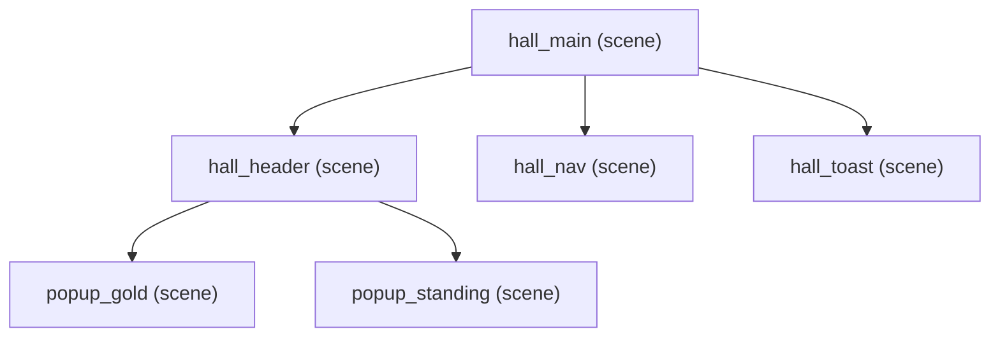
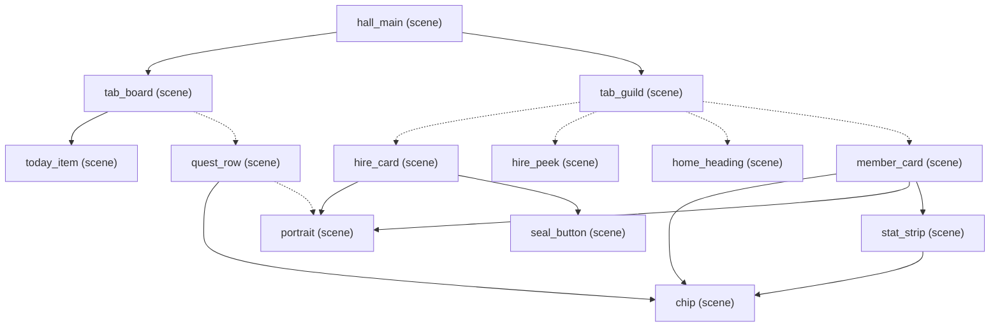
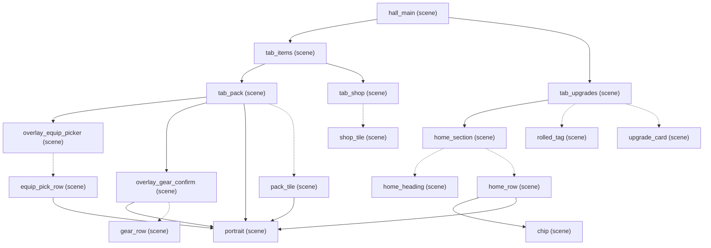
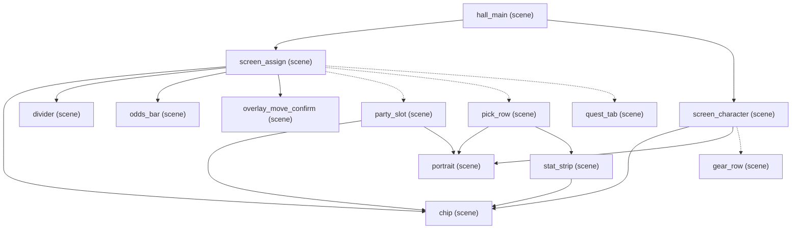
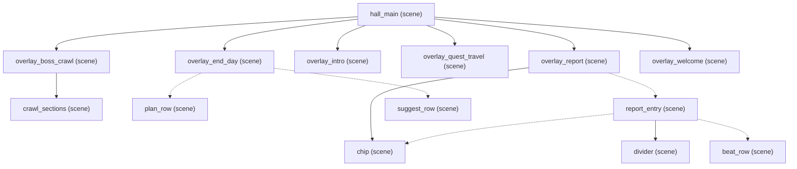
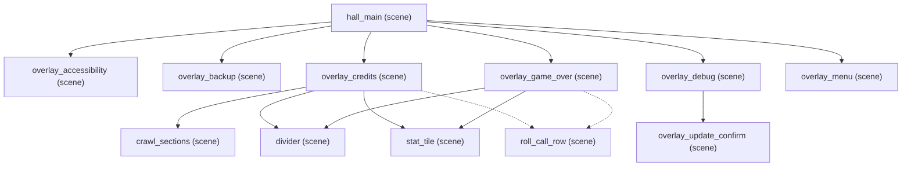
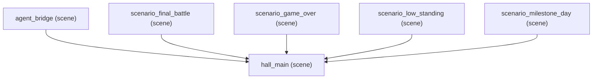

# Fantasy Guild Manager: code docs

This vault documents how the game's code works: every script and function, every scene, and how the major systems flow. The `docs-writer` agent maintains it, and the `/docs-vault` skill runs it. Each script note lists who calls what with `file:line`; each system note shows a flow as a sequence diagram plus a steps table whose "Returns (to)" lines up with a later step's "Takes (from)".

## Systems

- [[Boot and Autoload Order]]: the eight autoloads in order, then the hall's start-up.
- [[Day Cycle]]: one day from End Day through the night, the Day Report and the dawn.
- [[Hiring Characters]]: where new heroes come from, the daily For Hire pool and its prices.
- [[Party Drafting and Assignment]]: picking who goes on which quest on the Assign Party screen.
- [[Success Chance]]: how a party becomes one win chance, and where that number is shown.
- [[Quest Generation and Difficulty]]: how the day's quests, ranks, bosses and the difficulty staircase are built.
- [[Quest Resolution and Injuries]]: playing a quest out: gold, standing, Pluck, injuries, deaths and found items.
- [[Night - Training Hospital Revive]]: the night's training, healing, Hospital bill and reviving the fallen.
- [[Economy and Wallet]]: where gold and standing come from, where they go, and what each unlocks.
- [[Items and Shop]]: gear: the daily shop, rarity from standing, buying and role-locked equipping.
- [[Saving Migration and Backup Codes]]: the run's save file, version migration, and save codes for backups.
- [[Run End]]: danger warnings, Game Over, the final battle, credits and freeplay.
- [[UI Motion and Feedback]]: animations, counters, the dusk wash, crawls, sounds, Reduced Motion and Text size.
- [[UI Architecture and Refresh]]: how views get `setup(hall)` and `refresh()`, and how tabs and features unlock.
- [[Playtest Bridge]]: scenario scenes and the file bridge the AI playtesters drive.

## Scene tree
`hall_main (scene)` is the root of the game; every other game scene hangs under it. Solid lines (`-->`) are scenes placed in the editor; dotted lines (`-.->`) are scenes instanced at runtime by a script (rows built inside a tab's or overlay's `refresh`). Components such as `chip`, `portrait`, `divider` and `stat_strip` appear under every parent that uses them. The diagrams are split by area to stay readable.

### The hall's direct children
Every scene placed in `hall_main.tscn` (nothing is instanced under it at runtime).

```mermaid
flowchart TD
  hall_main["hall_main (scene)"]
  hall_header["hall_header (scene)"]
  hall_nav["hall_nav (scene)"]
  hall_toast["hall_toast (scene)"]
  overlay_accessibility["overlay_accessibility (scene)"]
  overlay_backup["overlay_backup (scene)"]
  overlay_boss_crawl["overlay_boss_crawl (scene)"]
  overlay_credits["overlay_credits (scene)"]
  overlay_debug["overlay_debug (scene)"]
  overlay_end_day["overlay_end_day (scene)"]
  overlay_game_over["overlay_game_over (scene)"]
  overlay_intro["overlay_intro (scene)"]
  overlay_menu["overlay_menu (scene)"]
  overlay_quest_travel["overlay_quest_travel (scene)"]
  overlay_report["overlay_report (scene)"]
  overlay_welcome["overlay_welcome (scene)"]
  screen_assign["screen_assign (scene)"]
  screen_character["screen_character (scene)"]
  tab_board["tab_board (scene)"]
  tab_guild["tab_guild (scene)"]
  tab_items["tab_items (scene)"]
  tab_upgrades["tab_upgrades (scene)"]
  hall_main --> hall_header
  hall_main --> hall_nav
  hall_main --> hall_toast
  hall_main --> overlay_accessibility
  hall_main --> overlay_backup
  hall_main --> overlay_boss_crawl
  hall_main --> overlay_credits
  hall_main --> overlay_debug
  hall_main --> overlay_end_day
  hall_main --> overlay_game_over
  hall_main --> overlay_intro
  hall_main --> overlay_menu
  hall_main --> overlay_quest_travel
  hall_main --> overlay_report
  hall_main --> overlay_welcome
  hall_main --> screen_assign
  hall_main --> screen_character
  hall_main --> tab_board
  hall_main --> tab_guild
  hall_main --> tab_items
  hall_main --> tab_upgrades
```

### Shell: header and popups

### Board and Guild tabs

### Items and Upgrades tabs

### Screens

### Day overlays

### Run End and Menu overlays

### Playtest run scenes
Top-level run scenes under `Scenes/Playtest/` with no parent. Each places the hall as a child.

## Scripts by folder
- **Globals**: [[character_container]], [[external_content_container]], [[game_state]], [[guild_upgrades]], [[item_container]], [[item_shop]], [[multicolumn_procedural_loader]], [[procedural_content_loader]], [[sound_effects]]
- **Scripts/Character Generator**: [[character_resource]]
- **Scripts/Credits**: [[credit_entry]], [[credits_list]]
- **Scripts/Hall**: [[hall_main]]
- **Scripts/Hall/Debug**: [[hall_debug]], [[run_logger]]
- **Scripts/Hall/Rules**: [[hall_gear]], [[hall_ledger]], [[hall_rules]], [[hall_wallet]], [[hire_scaling]]
- **Scripts/Hall/Save**: [[hall_save]], [[hall_save_transfer]], [[hall_settings]], [[hall_web_files]]
- **Scripts/Hall/Style**: [[hall_font_scale]], [[hall_fx]], [[hall_style]]
- **Scripts/Hall/Web**: [[hall_build_info]], [[hall_web_update]]
- **Scripts/Item System**: [[active_items]], [[passive_item]], [[standard_item]]
- **Scripts/Playtest**: [[agent_bridge]], [[agent_bridge_actions]], [[agent_bridge_eyes]], [[agent_bridge_state]], [[playtest_scenario]]
- **Scripts/Quest Creator**: [[quest_Manager]], [[quest_injuries]], [[quest_resource]], [[quest_scoring]], [[region_resource]]
- **Scripts/UI/Components**: [[chip]], [[crawl_roll]], [[crawl_sections]], [[drag_scroll]], [[odds_bar]], [[pixel_icon]], [[portrait]], [[stat_strip]], [[stat_tile]], [[tap_panel]]
- **Scripts/UI/Overlays/Day**: [[overlay_boss_crawl]], [[overlay_end_day]], [[overlay_intro]], [[overlay_move_confirm]], [[overlay_quest_travel]], [[overlay_report]], [[overlay_tutorial]], [[overlay_welcome]]
- **Scripts/UI/Overlays/Items**: [[overlay_equip_picker]], [[overlay_gear_confirm]]
- **Scripts/UI/Overlays/Menu**: [[overlay_accessibility]], [[overlay_backup]], [[overlay_debug]], [[overlay_menu]], [[overlay_update_confirm]]
- **Scripts/UI/Overlays/Run End**: [[overlay_credits]], [[overlay_game_over]]
- **Scripts/UI/Rows/Buildings**: [[home_row]], [[home_section]], [[upgrade_card]]
- **Scripts/UI/Rows/Day End**: [[beat_row]], [[plan_row]], [[report_entry]], [[roll_call_row]], [[suggest_row]]
- **Scripts/UI/Rows/Heroes**: [[hire_card]], [[member_card]]
- **Scripts/UI/Rows/Items**: [[equip_pick_row]], [[gear_row]], [[pack_tile]], [[shop_tile]]
- **Scripts/UI/Rows/Quests**: [[party_slot]], [[pick_row]], [[quest_row]], [[quest_tab]], [[today_item]]
- **Scripts/UI/Screens**: [[screen_assign]], [[screen_character]]
- **Scripts/UI/Shell**: [[hall_nav]], [[hall_toast]]
- **Scripts/UI/Shell/Header**: [[hall_header]], [[header_popup]], [[popup_gold]], [[popup_standing]]
- **Scripts/UI/Tabs**: [[tab_board]], [[tab_guild]], [[tab_items]], [[tab_pack]], [[tab_shop]], [[tab_upgrades]]

## Scenes by folder
- **Scenes**: [[hall_main (scene)]]
- **Scenes/Components**: [[chip (scene)]], [[crawl_sections (scene)]], [[divider (scene)]], [[odds_bar (scene)]], [[portrait (scene)]], [[rolled_tag (scene)]], [[seal_button (scene)]], [[stat_strip (scene)]], [[stat_tile (scene)]]
- **Scenes/Overlays/Day**: [[overlay_boss_crawl (scene)]], [[overlay_end_day (scene)]], [[overlay_intro (scene)]], [[overlay_move_confirm (scene)]], [[overlay_quest_travel (scene)]], [[overlay_report (scene)]], [[overlay_welcome (scene)]]
- **Scenes/Overlays/Items**: [[overlay_equip_picker (scene)]], [[overlay_gear_confirm (scene)]]
- **Scenes/Overlays/Menu**: [[overlay_accessibility (scene)]], [[overlay_backup (scene)]], [[overlay_debug (scene)]], [[overlay_menu (scene)]], [[overlay_update_confirm (scene)]]
- **Scenes/Overlays/Run End**: [[overlay_credits (scene)]], [[overlay_game_over (scene)]]
- **Scenes/Playtest**: [[agent_bridge (scene)]], [[scenario_final_battle (scene)]], [[scenario_game_over (scene)]], [[scenario_low_standing (scene)]], [[scenario_milestone_day (scene)]]
- **Scenes/Rows/Buildings**: [[home_heading (scene)]], [[home_row (scene)]], [[home_section (scene)]], [[upgrade_card (scene)]]
- **Scenes/Rows/Day End**: [[beat_row (scene)]], [[plan_row (scene)]], [[report_entry (scene)]], [[roll_call_row (scene)]], [[suggest_row (scene)]]
- **Scenes/Rows/Heroes**: [[hire_card (scene)]], [[hire_peek (scene)]], [[member_card (scene)]]
- **Scenes/Rows/Items**: [[equip_pick_row (scene)]], [[gear_row (scene)]], [[pack_tile (scene)]], [[shop_tile (scene)]]
- **Scenes/Rows/Quests**: [[party_slot (scene)]], [[pick_row (scene)]], [[quest_row (scene)]], [[quest_tab (scene)]], [[today_item (scene)]]
- **Scenes/Screens**: [[screen_assign (scene)]], [[screen_character (scene)]]
- **Scenes/Shell**: [[hall_nav (scene)]], [[hall_toast (scene)]]
- **Scenes/Shell/Header**: [[hall_header (scene)]], [[popup_gold (scene)]], [[popup_standing (scene)]]
- **Scenes/Tabs**: [[tab_board (scene)]], [[tab_guild (scene)]], [[tab_items (scene)]], [[tab_pack (scene)]], [[tab_shop (scene)]], [[tab_upgrades (scene)]]

## Tests
`tools/tests/*_test.tscn` (run with `bash tools/tests/run_test.sh <name>`). Listed here only, not documented.
