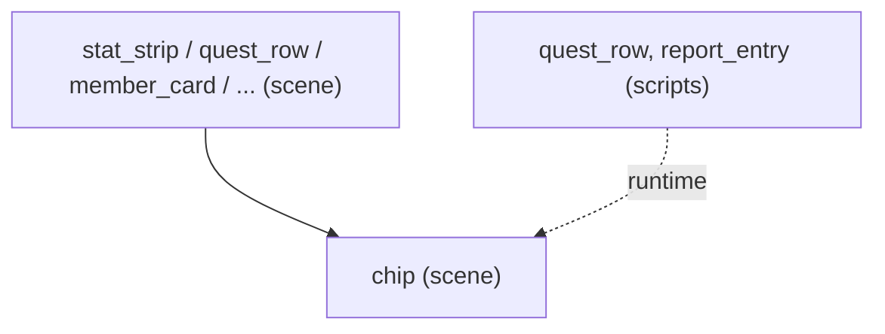

# chip.tscn

## Purpose
A small ink label with an optional icon and outline: stats, health, gold, rank, party size, the Story Quest ribbon and other short facts. The look is chosen in code by [[chip#set_chip]], [[chip#set_box]], [[chip#set_filled]], [[chip#set_health]] and [[chip#set_stat]].

## Parent scenes
- **Placed in editor:** [[stat_strip (scene)]] at `Health`, `AtRisk`, `Stat0` to `Stat4`; [[overlay_report (scene)]] at `Layout/TotalsMargin/Totals/Chips/WinsChip`, `GoldChip`, `HurtChip`, `DeadChip`; [[home_row (scene)]] at `Col/Row/Info/Chips/HealthChip`, `TaskChip`; [[member_card (scene)]] at `Row/Info/Mid/TaskChip`; [[party_slot (scene)]] at `Row/Info/FavChip`; [[quest_row (scene)]] at `Row/BodyMargin/Body/Content/Info/Chips/RankChip`, `GoldChip`, `SlotsChip`, `FavChip`; [[screen_assign (scene)]] at `Scroll/Margin/Col/Writ/WritMargin/QuestCard/Col/Chips/GoldChip`, `StandingChip`, `SlotsChip`, `FavChip`; [[screen_character (scene)]] at `Scroll/Margin/Paper/Col/Head/Info/HealthRow/HealthChip`.
- **Instanced at runtime:** by [[quest_row#_show_story_look]] (`quest_row.gd:105`) and [[report_entry#_show_story_look]] (`report_entry.gd:202`), both as the Story Quest ribbon. The parent scenes are [[quest_row (scene)]] and [[report_entry (scene)]].

## Child scenes
- **Placed in editor:** none.
- **Instanced at runtime:** none.

## Node tree
- `Chip` (PanelContainer), script [[chip]]
  - `Row` (HBoxContainer): layout
    - `Icon` (TextureRect): hidden when there is no icon
    - `Text` (Label): the chip text
  - Neither child is a `%` node; [[chip]] finds them as `$Row/Icon` and `$Row/Text`.

## Scripts attached
- Root: [[chip]].
- Other nodes: none.

## Resources used
- Outline art `Themes/Styles/pill.tres` or `ink_box.tres`, chosen by theme variation in code.
