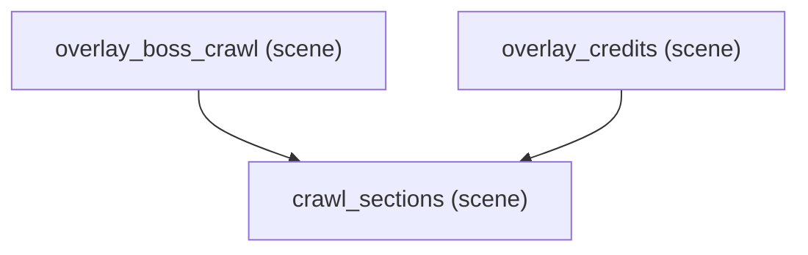

# crawl_sections.tscn

## Purpose
The text part of a film-style crawl: a title, a subtitle and a column of fights (story lines, party, outcome). Shared by the final credits and the boss fights' crawl. Belongs to [[UI Motion and Feedback]].

## Parent scenes
- **Placed in editor:** [[overlay_boss_crawl (scene)]] at `Scroll/Margin/Roll/Sections`; [[overlay_credits (scene)]] at `Scroll/Margin/Roll/Sections`.
- **Instanced at runtime:** none.

## Child scenes
- **Placed in editor:** none.
- **Instanced at runtime:** none (the labels, story columns and party rows are plain nodes built in code by [[crawl_sections#add_fight]]).

## Node tree
- `CrawlSections` (VBoxContainer), script [[crawl_sections]]
  - `%Title` (Label), `%Sub` (Label): set in [[crawl_sections#show_title]]
  - `%Fights` (VBoxContainer): holds the runtime fight blocks

## Scripts attached
- Root: [[crawl_sections]].
- Other nodes: none.

## Resources used
- None.
