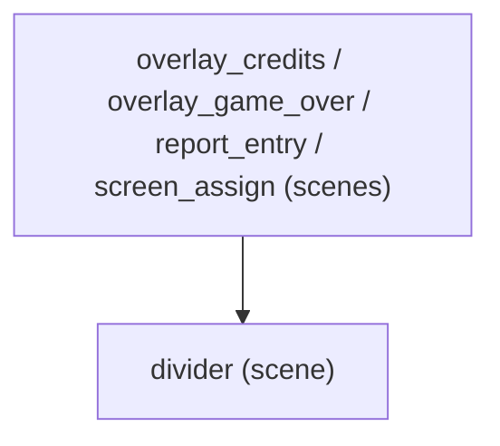

# divider.tscn

## Purpose
A thin horizontal rule with a red diamond in the middle, used to separate sections on parchment. It has no script and ignores the mouse.

## Parent scenes
- **Placed in editor:** [[overlay_credits (scene)]] at `Scroll/Margin/Roll/Ledger/Col/RecordsDivider` and `RollCallDivider`; [[overlay_game_over (scene)]] at `Layout/Scroll/Margin/Ledger/Col/Divider`; [[report_entry (scene)]] at `Col/Divider` and `Col/Divider2`; [[screen_assign (scene)]] at `Scroll/Margin/Col/Writ/WritMargin/QuestCard/Col/Divider`.
- **Instanced at runtime:** none.

## Child scenes
- **Placed in editor:** none.
- **Instanced at runtime:** none.

## Node tree
- `Divider` (HBoxContainer)
  - `Left` (ColorRect, 2 px tall)
  - `Diamond` (TextureRect, 16 x 16, tinted red)
  - `Right` (ColorRect, 2 px tall)

## Scripts attached
- None. (The folded letter hides it through [[report_entry]]'s `_foldable` list.)

## Resources used
- Texture `Sprites/Hall Icons/diamond.tres`.
