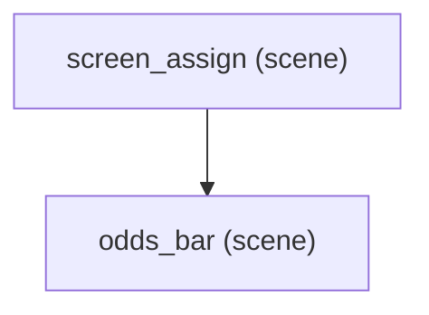

# odds_bar.tscn

## Purpose
The success-chance bar in Assign Party: a hatched fill over a paper track with quarter ticks on top. Belongs to [[Success Chance]].

## Parent scenes
- **Placed in editor:** [[screen_assign (scene)]] at `Scroll/Margin/Col/Writ/WritMargin/QuestCard/Col/PartyBox/OddsBar`.
- **Instanced at runtime:** none.

## Child scenes
- **Placed in editor:** none.
- **Instanced at runtime:** none.

## Node tree
- `OddsBar` (TextureProgressBar), script [[odds_bar]]: a single node; its three textures are the track, fill and overlay.

## Scripts attached
- Root: [[odds_bar]]. `set_chance(chance, animate)`.
- Other nodes: none.

## Resources used
- Textures `Sprites/UI Textures/odds_track.png`, `odds_fill.png`, `odds_over.png`.
