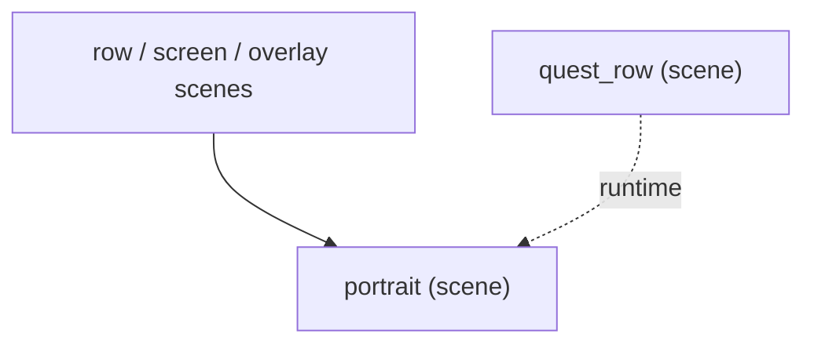

# portrait.tscn

## Purpose
A hero's portrait: their art clipped to an oval or circle on a role-coloured ground, inside an ink frame, with an optional red pin. The size is set on each instance with `custom_minimum_size`; `circle` and `pinned` are exported flags.

## Parent scenes
- **Placed in editor:** [[overlay_gear_confirm (scene)]] at `Margin/Center/Sheet/Col/Portrait`; [[home_row (scene)]] at `Col/Row/Portrait`; [[hire_card (scene)]] at `Col/Top/Portrait`; [[member_card (scene)]] at `Row/Portrait`; [[equip_pick_row (scene)]] at `Row/Portrait`; [[pack_tile (scene)]] at `Medallion`; [[party_slot (scene)]] at `Row/Portrait`; [[pick_row (scene)]] at `Row/Portrait`; [[screen_character (scene)]] at `Scroll/Margin/Paper/Col/Head/Portrait`; [[tab_pack (scene)]] at `ItemBar/Banner/Row/WearerPortrait`.
- **Instanced at runtime:** by [[quest_row#_show_party]] (`quest_row.gd:117`), one per party member, with `circle` set to true. The parent scene is [[quest_row (scene)]].

## Child scenes
- **Placed in editor:** none.
- **Instanced at runtime:** none.

## Node tree
- `Portrait` (Control), script [[portrait]]
  - `Mask` (TextureRect) with `Art` (TextureRect): the character art, clipped by shader
  - `Frame` (TextureRect): the ink frame
  - `Pin` (TextureRect): the red pin, shown when `pinned`
  - None are `%` nodes; [[portrait]] finds them by path.

## Scripts attached
- Root: [[portrait]]. `show_character(character)`.
- Other nodes: none.

## Resources used
- Textures `Sprites/UI Textures/portrait_oval_mask.png`, `portrait_oval_frame.png`, `pin_red.png`, `Sprites/Character Icons/knight_icon.png` (placeholder art).
