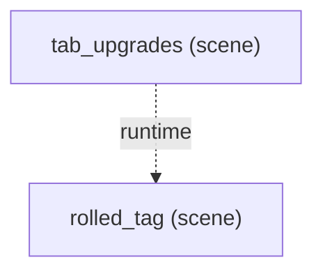

# rolled_tag.tscn

## Purpose
A rolled-up scroll with a building's name on a tag, shown for buildings that are not implemented yet ("coming soon"). It has no script.

## Parent scenes
- **Placed in editor:** none.
- **Instanced at runtime:** by [[tab_upgrades#_show_coming_soon]] (`tab_upgrades.gd:122`), which hands the preloaded scene to `HallStyle.add_row` and sets the text of `Center/Tag/Text` with `get_node`. The parent scene is [[tab_upgrades (scene)]].

## Child scenes
- **Placed in editor:** none.
- **Instanced at runtime:** none.

## Node tree
- `RolledTag` (TextureRect, 212 x 70 minimum, mouse ignored)
  - `Center` (CenterContainer): layout
    - `Tag` (PanelContainer, `TagLabel` variation) with `Text` (Label, `TitleLabel`): the building name. Not a `%` node.

## Scripts attached
- None.

## Resources used
- Texture `Sprites/UI Textures/rolled_scroll.png`.
