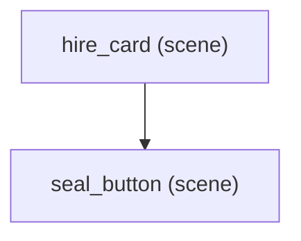

# seal_button.tscn

## Purpose
A wide button with a wax seal pinned to its left end (`SealButton` theme variation), used for the Hire button on an applicant's letter. It has no script; its text and `pressed` are handled by the parent.

## Parent scenes
- **Placed in editor:** [[hire_card (scene)]] at `Col/Buttons/HireButton`.
- **Instanced at runtime:** none.

## Child scenes
- **Placed in editor:** none.
- **Instanced at runtime:** none.

## Node tree
- `SealButton` (Button, 92 px tall minimum, text "Seal & send" by default)
  - `Seal` (TextureRect): the wax seal, anchored at the left. Not a `%` node.

## Scripts attached
- None. [[hire_card]] sets `text` and `disabled` and connects `pressed` through `%HireButton`.

## Resources used
- Texture `Sprites/UI Textures/wax_seal.png`.
