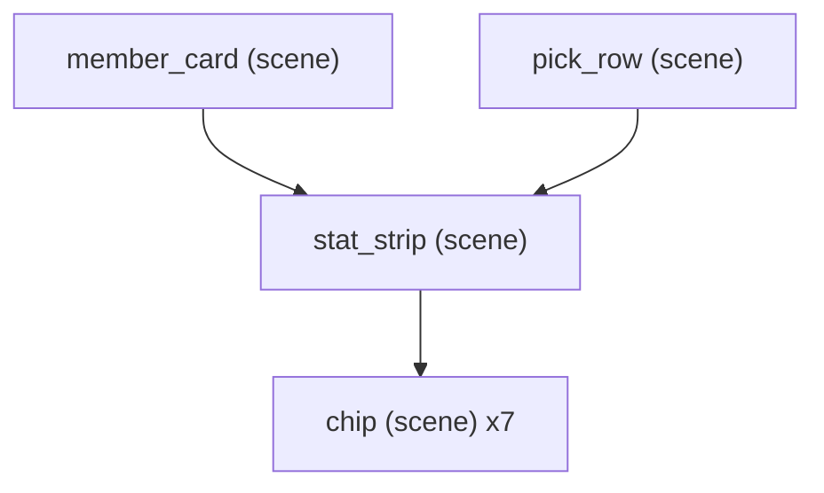

# stat_strip.tscn

## Purpose
A wrapping row of chips: a health chip, an "At risk" chip and one chip per stat (`Stat0` to `Stat4`, in `HallStyle.STATS` order). Used on roster cards and in the Assign Party picker.

## Parent scenes
- **Placed in editor:** [[member_card (scene)]] at `Row/Info/Stats`; [[pick_row (scene)]] at `Row/Info/Stats`.
- **Instanced at runtime:** none.

## Child scenes
- **Placed in editor:** [[chip (scene)]] at `Health`, `AtRisk`, `Stat0`, `Stat1`, `Stat2`, `Stat3`, `Stat4`.
- **Instanced at runtime:** none.

## Node tree
- `StatStrip` (HFlowContainer), script [[stat_strip]]
  - `%Health` ([[chip]]): set in [[stat_strip#show_health]]
  - `%AtRisk` ([[chip]]): the "At risk" tag
  - `Stat0` to `Stat4` ([[chip]]): found by name in [[stat_strip#show_stats]]

## Scripts attached
- Root: [[stat_strip]].
- Other nodes: [[chip]] on every chip.

## Resources used
- None beyond the chip scene.
