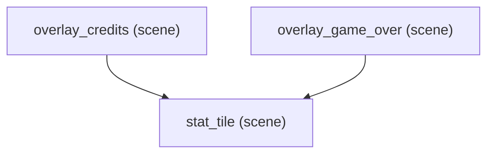

# stat_tile.tscn

## Purpose
One number in an ink box with a caption under it ("1240" / "gold earned"), used for the stat grids on the credits ledger and the Game Over ledger. Belongs to [[Run End]].

## Parent scenes
- **Placed in editor:** [[overlay_credits (scene)]] at `Scroll/Margin/Roll/Ledger/Col/DaysRow/DaysTile`, `Grid/GoldTile`, `QuestsTile`, `HiredTile`, `FallenTile`, `StandingTile`, `SpentTile`, and `RecordsGrid/ItemsTile`, `ServiceTile`; [[overlay_game_over (scene)]] at `Layout/Scroll/Margin/Ledger/Col/DaysRow/DaysTile` and `Grid/GoldTile`, `QuestsTile`, `HiredTile`, `FallenTile`, `StandingTile`, `DrakeTile`.
- **Instanced at runtime:** none.

## Child scenes
- **Placed in editor:** none.
- **Instanced at runtime:** none.

## Node tree
- `StatTile` (PanelContainer), script [[stat_tile]]
  - `Col` (VBoxContainer): layout
    - `%Value` (Label), `%Caption` (Label): set in [[stat_tile#setup]]

## Scripts attached
- Root: [[stat_tile]]. `setup(value_text, caption_text, ink, value_font_size)`.
- Other nodes: none.

## Resources used
- None.
