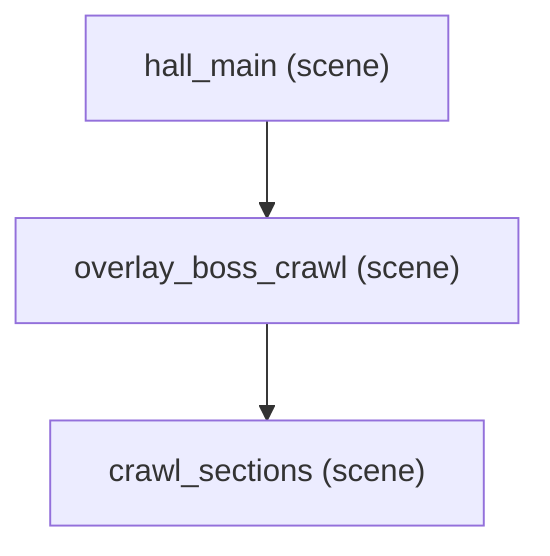

# overlay_boss_crawl.tscn

## Purpose
The text crawl of the night's boss fights (days 10, 20, 30, 40) that rolls up the screen before the Day Report; Continue opens the report. See [[overlay_boss_crawl]].

## Parent scenes
- **Placed in editor:** [[hall_main (scene)]] at node `OverlayBossCrawl`. Shown or hidden by [[hall_main#_refresh_overlays]] (`hall_main.gd:1870`).
- No runtime parents.

## Child scenes
- **Placed in editor:** [[crawl_sections (scene)]] at node `Scroll/Margin/Roll/Sections` (script [[crawl_sections]]; filled by [[overlay_boss_crawl#refresh]]).
- No runtime children.

## Node tree
- `OverlayBossCrawl` (Control), script [[overlay_boss_crawl]]
  - `%Bg` (ColorRect): victory or defeat colour, set in [[overlay_boss_crawl#refresh]]
  - `%Scroll` (ScrollContainer): the roll, driven by [[crawl_roll]]
    - `Margin/Roll`: layout (summarized)
      - `%TopSpace`, `%BottomSpace` (Control): blank space before and after the text
      - `%Sections` ([[crawl_sections (scene)]]): the title and fight blocks
  - `%Footer` (MarginContainer): pinned bottom bar
    - `Col/Connector` (TextureRect): the sign's strings
    - `%ContinueButton` (Button): `pressed` -> [[hall_main#close_boss_crawl]] (connected in [[overlay_boss_crawl#setup]])

## Scripts attached
- Root: [[overlay_boss_crawl]]. `setup(hall)` stores the hall; `refresh()` builds the crawl from `hall.shown_boss_crawl`.
- Other nodes: [[crawl_sections]] on `%Sections`; a [[crawl_roll]] node is added at runtime.

## Resources used
- Texture `Sprites/UI Textures/connector.png`
