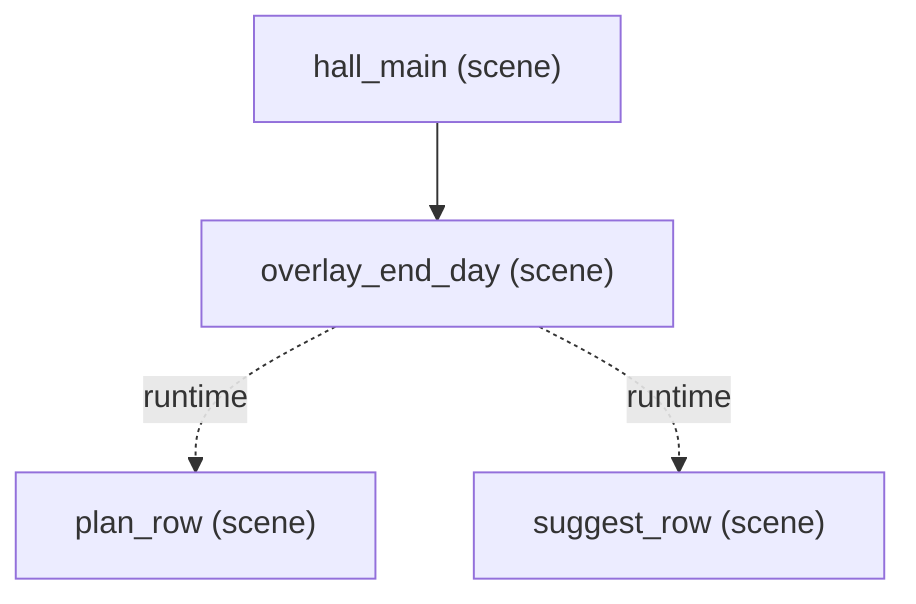

# overlay_end_day.tscn

## Purpose
The End Day check sheet: who goes out tonight, the denied quests, and affordable upgrade suggestions, with Not yet and End Day buttons. See [[overlay_end_day]].

## Parent scenes
- **Placed in editor:** [[hall_main (scene)]] at node `OverlayEndDay`. Shown or hidden by [[hall_main#_refresh_overlays]] (`hall_main.gd:1845`).
- No runtime parents.

## Child scenes
- **Instanced at runtime:** [[plan_row (scene)]], created by [[overlay_end_day#_show_tonights_plan]] (`overlay_end_day.gd:77`, passed to `HallStyle.add_row`), into `%PlanList`.
- **Instanced at runtime:** [[suggest_row (scene)]], created by [[overlay_end_day#_show_upgrade_suggestions]] (`overlay_end_day.gd:94`, passed to `HallStyle.add_row`), into `%SuggestList`.

## Node tree
- `OverlayEndDay` (Control), script [[overlay_end_day]]
  - `%Dim` (PanelContainer): dark backdrop; `gui_input` -> [[overlay_end_day#_on_dim_input]]
  - `Sheet/Col`: layout (summarized)
    - `%Title` (Label), `%Sub` (Label): set in [[overlay_end_day#refresh]] and [[overlay_end_day#_show_tonights_plan]]
    - `%PlanList` (VBoxContainer): holds the runtime plan rows
    - `%Denied` (Label): denied quest titles
    - `%UpgradeBox` (PanelContainer): shown only when something is affordable
      - `%UpgradeTitle` (Label), `%SuggestList` (VBoxContainer): holds the runtime suggestion rows
    - `Buttons`: `%BackButton` (Button): `pressed` -> [[hall_main#close_end_check]]; `%EndButton` (Button): `pressed` -> [[hall_main#end_day]]

## Scripts attached
- Root: [[overlay_end_day]]. `setup(hall)` stores the hall and connects buttons; `refresh()` redraws from hall queries.
- Other nodes: none.

## Resources used
- StyleBox `Themes/Styles/dim.tres`
