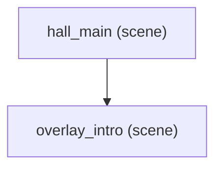

# overlay_intro.tscn

## Purpose
The intro story crawl shown once per save at the start of a new run, in gold ink on black; Begin ('Open the Doors') hands over to Pip's Day 1 tutorial. See [[overlay_intro]].

## Parent scenes
- **Placed in editor:** [[hall_main (scene)]] at node `OverlayIntro`. Shown or hidden by [[hall_main#_refresh_overlays]] (`hall_main.gd:1870`).
- No runtime parents.

## Child scenes
- None placed. The story paragraphs are `RichTextLabel` nodes added at runtime to `%Story` by [[overlay_intro#_show_text]] (not scenes).

## Node tree
- `OverlayIntro` (Control), script [[overlay_intro]]
  - `%Bg` (ColorRect): black (`HallStyle.INTRO_BG`)
  - `%Scroll` (ScrollContainer): the roll, driven by [[crawl_roll]]
    - `Margin/Roll`: layout (summarized)
      - `%TopSpace`, `%BottomSpace` (Control): blank space
      - `%Title`, `%Sub`, `%End` (Label): title, subtitle, closing line
      - `%Story` (VBoxContainer): holds the runtime paragraph labels
      - `StoryGap`, `EndGap` (Control): spacing
  - `%Footer` (MarginContainer): pinned bottom bar
    - `Col/Connector` (TextureRect): the sign's strings
    - `%BeginButton` (Button): `pressed` -> [[hall_main#close_intro]]

## Scripts attached
- Root: [[overlay_intro]]. `setup(hall)` builds the text once; `refresh()` starts the roll when it opens.
- Other nodes: none (a [[crawl_roll]] node is added at runtime).

## Resources used
- Texture `Sprites/UI Textures/connector.png`
