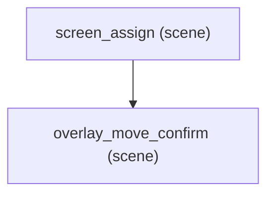

# overlay_move_confirm.tscn

## Purpose
A small popup 'Move X?' asked when a hero already in another quest's party is tapped in Assign Party's picker. Cancel or Move. See [[overlay_move_confirm]].

## Parent scenes
- **Placed in editor:** [[screen_assign (scene)]] at node `MoveConfirm` (`top_level` is on, so it draws over the whole screen). Set up by [[screen_assign#setup]] (`screen_assign.gd:155`); opened through the callable handed to the pick rows ([[screen_assign#_show_picker]], `screen_assign.gd:370`).
- No runtime parents.

## Child scenes
- None.

## Node tree
- `OverlayMoveConfirm` (Control, `top_level`), script [[overlay_move_confirm]]
  - `%Dim` (PanelContainer): backdrop; `gui_input` -> [[overlay_move_confirm#_on_dim_input]]
  - `Margin/Center/Sheet/Col`: layout (summarized)
    - `%Title`, `%Body`, `%Note` (Label): set in [[overlay_move_confirm#open]]
    - `Buttons`: `%CancelButton` (Button): `pressed` -> [[overlay_move_confirm#close]]; `%MoveButton` (Button): `pressed` -> [[overlay_move_confirm#_on_move_pressed]]

## Scripts attached
- Root: [[overlay_move_confirm]]. `setup(hall)` stores the hall and connects buttons; it has `open(character)` and `close()` instead of using `refresh()`.
- Other nodes: none.

## Resources used
- StyleBox `Themes/Styles/dim.tres`
