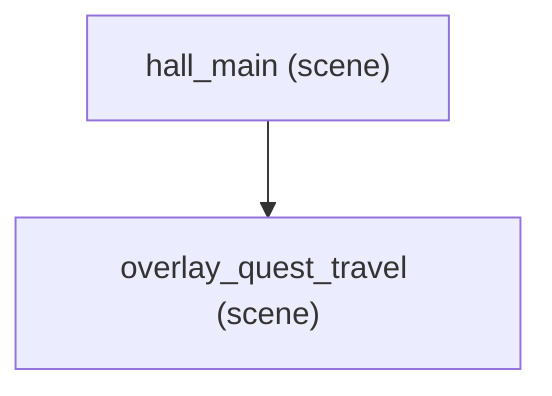

# overlay_quest_travel.tscn

## Purpose
The "Going on a quest" screen between End Day and the Day Report (or boss crawl, or final credits): a black screen with a walker, a title with cycling dots and, after 2 to 4 seconds, a "View quest report" button. See [[overlay_quest_travel]], [[Day Cycle]] and [[UI Motion and Feedback]].

## Parent scenes
- **Placed in editor:** [[hall_main (scene)]] at node `OverlayQuestTravel` (`hall_main.tscn:202`, hidden, `z_index` 10). Shown or hidden by [[hall_main#_refresh_overlays]] (`hall_main.gd:1914`).
- No runtime parents.

## Child scenes
- None placed or instanced.

## Node tree
- `OverlayQuestTravel` (Control, full rect), script [[overlay_quest_travel]]
  - `%Bg` (ColorRect): black, set to `HallStyle.INTRO_BG` in [[overlay_quest_travel#setup]]
  - `%Backdrop` (TextureRect): empty art slot, ignores the mouse
  - `%WalkerHolder` (Control): 260 x 260 px box at 42% height
    - `%Walker` (AnimatedSprite2D): empty `SpriteFrames` (`default`, loops, 8 fps); bobbed in [[overlay_quest_travel#_process]]
  - `%Title` (Label): "Going on a quest" plus dots, set in [[overlay_quest_travel#_update_title]]
  - `Footer` (MarginContainer): pinned bottom bar (layout)
    - `%ContinueButton` (Button, `GoldButton`): hidden and disabled until the wait ends; `pressed` -> [[overlay_quest_travel#_on_continue_pressed]]

## Scripts attached
- Root: [[overlay_quest_travel]]. `setup(hall)` stores the hall; `refresh()` starts a trip.
- Other nodes: none.

## Resources used
- Theme variation `GoldButton`; no textures yet (art slots empty).
