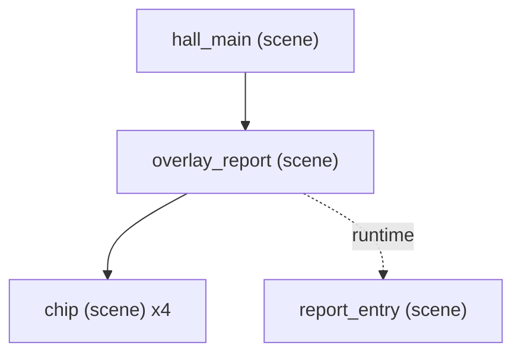

# overlay_report.tscn

## Purpose
The Day Report: totals strip, home, hospital and released notes, and one folded or open letter per quest, with a hanging sign button that starts the next day (after End Day) or closes (from the Menu). See [[overlay_report]].

## Parent scenes
- **Placed in editor:** [[hall_main (scene)]] at node `OverlayReport`. Shown or hidden by [[hall_main#_refresh_overlays]] (`hall_main.gd:1870`).
- No runtime parents.

## Child scenes
- **Placed in editor:** [[chip (scene)]] at `Layout/TotalsMargin/Totals/Chips/WinsChip`, `GoldChip`, `HurtChip` and `DeadChip` (script [[chip]]).
- **Instanced at runtime:** [[report_entry (scene)]], created by [[overlay_report#_show_entries]] (`overlay_report.gd:286`, passed to `HallStyle.add_row`), into `%Entries`.

## Node tree
- `OverlayReport` (Control), script [[overlay_report]]
  - `Bg` (TextureRect): paper background
  - `Layout` (VBoxContainer): layout (summarized)
    - `HeadMargin/Head`: `%Title` (Label) day title; `%Sub` (Label) letters note (hidden by `SHOW_LETTERS_NOTE`)
    - `%Totals` (PanelContainer) with `Chips`: `%WinsChip`, `%GoldChip`, `%HurtChip`, `%DeadChip` ([[chip (scene)]]), set in [[overlay_report#_show_totals]]
    - `HomeMargin/Notes`: `%HomeNote`, `%HospitalNote` (Label, hidden until the night had a Hospital bill or an unpaid patient; filled by [[overlay_report#_show_hospital]]), `%ReleasedNote` (Label)
    - `%Scroll` (ScrollContainer): `Margin/Col` holding `%Entries` (VBoxContainer, runtime letters) and `%Empty` (Label)
    - `Footer/Col`: `Connector` (TextureRect); `%ActionButton` (Button): `pressed` -> [[hall_main#close_report]]. Its parent is swung as one sign in [[overlay_report#_play_reveal]]
  - `%ScrollArrow` (TextureRect): bobbing arrow, positioned in [[overlay_report#_update_scroll_arrow]]

## Scripts attached
- Root: [[overlay_report]]. `setup(hall)` connects the action button; `refresh()` rebuilds when a different report opens.
- Other nodes: [[chip]] on the four chips.

## Resources used
- Textures `Sprites/UI Textures/wood.png`, `Sprites/UI Textures/connector.png`, `Sprites/Hall Icons/arrow_left.tres`
