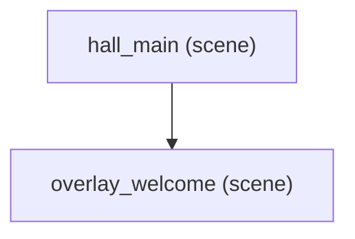

# overlay_welcome.tscn

## Purpose
The 'How to Play' sheet. Its authored rows are the Basics page (shown as 'Welcome, Guildmaster' on a fresh run with the tutorial off); the script wraps them into a topic menu and builds the other topic pages. See [[overlay_welcome]].

## Parent scenes
- **Placed in editor:** [[hall_main (scene)]] at node `OverlayWelcome`. Shown or hidden by [[hall_main#_refresh_overlays]] (`hall_main.gd:1845`).
- No runtime parents.

## Child scenes
- None placed. Topic pages and their rows are plain nodes built in code by [[overlay_welcome#setup]] and [[overlay_welcome#_build_row]] (not scenes).

## Node tree
- `OverlayWelcome` (Control), script [[overlay_welcome]]
  - `%Dim` (PanelContainer): backdrop
  - `Center/Sheet/Col` (VBoxContainer): the sheet; the script inserts a `ScrollContainer` here and moves the rows below into the Basics page
    - `Title` (Label): the page title, set in [[overlay_welcome#_show]]
    - `Intro` (Label) and five authored step rows `StepBoard`, `StepGuild`, `StepUpgrades`, `StepThebigbutton`, `StepFalls` (each `Icon` TextureRect + `Text/Name` + `Text/Body` Labels): the Basics text, reparented at runtime
    - `%StartButton` (Button): `pressed` -> [[overlay_welcome#_on_close]]; moved into a footer row next to a runtime Back button

## Scripts attached
- Root: [[overlay_welcome]]. `setup(hall)` builds the menu and pages; `refresh()` does nothing.
- Other nodes: none.

## Resources used
- StyleBox `Themes/Styles/dim.tres`; icons `Sprites/Hall Icons/scroll.tres`, `person.tres`, `hammer.tres`, `skull.tres` (topic icons are loaded in code from `Sprites/Hall Icons/`)
