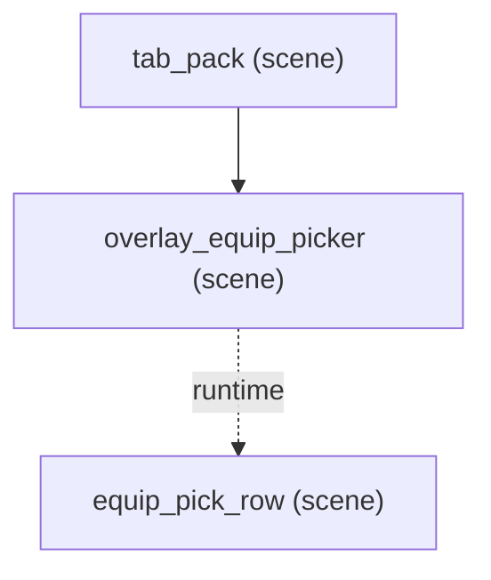

# overlay_equip_picker.tscn

## Purpose
The sheet that opens from the Pack's "Equip on..." button: it lists the heroes who can wear the selected item, each with Equip or Swap..., plus the heroes of the wrong role and Cancel. Hidden at start, `top_level` (draws over the whole screen). See [[overlay_equip_picker]].

## Parent scenes
- **Placed in editor:** [[tab_pack (scene)]] at node `EquipPicker`. Opened by [[tab_pack#_on_action_pressed]] (`tab_pack.gd:233`).
- No runtime parents.

## Child scenes
- **Instanced at runtime:** [[equip_pick_row (scene)]], created by [[overlay_equip_picker#refresh]] (`overlay_equip_picker.gd:80`) through `HallStyle.add_row`.

## Node tree
- `OverlayEquipPicker` (Control, hidden, `top_level`), script [[overlay_equip_picker]]
  - `%Dim` (PanelContainer): backdrop; `gui_input` -> [[overlay_equip_picker#_on_dim_input]]
  - `Sheet/Col`: layout (summarized)
    - `Head`: `%Tag` (PanelContainer) with `%TagText` (Label) and `%TagIcon` (TextureRect), the item's seal; `Text/%Title`, `Text/%Effect` (Label)
    - `%CanWear` (Label): heading
    - `%Fits` (VBoxContainer): holds the runtime pick rows
    - `%NoneNote`, `%WrongRole` (Label, hidden until needed)
    - `%CancelButton` (Button): `pressed` -> emits `closed`

## Scripts attached
- Root: [[overlay_equip_picker]]. It has `open(item)`, `close()` and `refresh()`, no `setup(hall)`.
- Other nodes: none.

## Resources used
- StyleBox `Themes/Styles/dim.tres`; texture `Sprites/Item Icons/sword_icon.png` (placeholder icon on `%TagIcon`)
