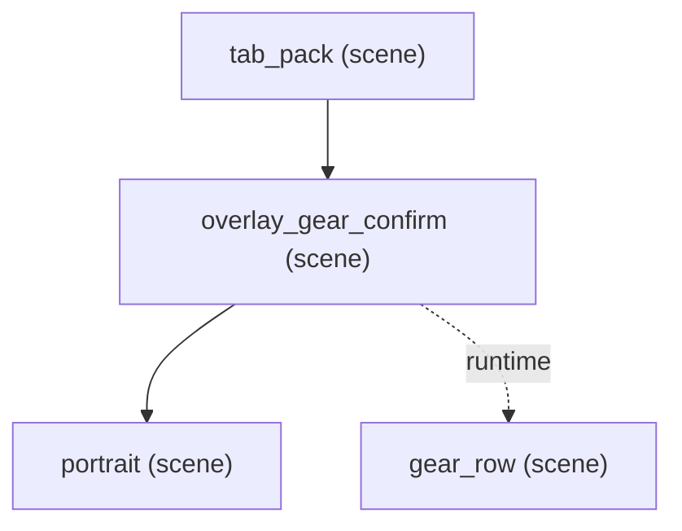

# overlay_gear_confirm.tscn

## Purpose
The popup asked before gear comes off a hero: "Take the X off Y?" (Keep it on / Take off) or, when slots are full, which worn item to swap out (Cancel / Swap). Hidden at start, `top_level`. See [[overlay_gear_confirm]].

## Parent scenes
- **Placed in editor:** [[tab_pack (scene)]] at node `GearConfirm`. Opened by [[tab_pack#_on_action_pressed]] (`tab_pack.gd:231`) and [[tab_pack#_on_swap_chosen]] (`tab_pack.gd:245`).
- No runtime parents.

## Child scenes
- **Placed in editor:** [[portrait (scene)]] at node `Margin/Center/Sheet/Col/Portrait`
- **Instanced at runtime:** [[gear_row (scene)]], created by [[overlay_gear_confirm#_show_swap]] (`overlay_gear_confirm.gd:137`) through `HallStyle.add_row`.

## Node tree
- `OverlayGearConfirm` (Control, hidden, `top_level`), script [[overlay_gear_confirm]]
  - `%Dim` (PanelContainer): backdrop; `gui_input` -> [[overlay_gear_confirm#_on_dim_input]]
  - `Margin/Center/Sheet/Col`: layout (summarized)
    - `%Portrait`: [[portrait (scene)]], `show_character` in the show functions
    - `%Title`, `%OnLine`, `%ChoiceHeading`, `%Note` (Label); `%Changes` (RichTextLabel, stat change preview)
    - `%Choices` (VBoxContainer): holds the runtime gear rows (swap only)
    - `Buttons`: `%CancelButton` (Button): `pressed` -> emits `closed`; `%ConfirmButton` (Button): `pressed` -> [[overlay_gear_confirm#_on_confirm]]

## Scripts attached
- Root: [[overlay_gear_confirm]]. It has `open_take_off`, `open_swap`, `close` and `refresh`, no `setup(hall)`.
- Other nodes: [[portrait]] on `%Portrait`.

## Resources used
- StyleBox `Themes/Styles/dim.tres`
