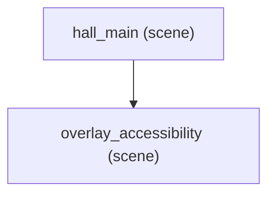

# overlay_accessibility.tscn

## Purpose
The Accessibility sheet reached from the Menu: buttons for Text size, Colorblind filter and Reduced motion, each stepping to the next choice, and Back. See [[overlay_accessibility]].

## Parent scenes
- **Placed in editor:** [[hall_main (scene)]] at node `OverlayAccessibility`. Shown by [[hall_main#_refresh_overlays]] (`hall_main.gd:1857`).
- No runtime parents.

## Child scenes
- None.

## Node tree
- `OverlayAccessibility` (Control), script [[overlay_accessibility]]
  - `%Dim` (PanelContainer): backdrop; `gui_input` -> [[overlay_accessibility#_on_dim_input]]
  - `Center/Sheet/Col`: layout (summarized)
    - `%TextSizeButton` (Button): `pressed` -> [[hall_main#cycle_text_size]]
    - `%ColorButton` (Button): `pressed` -> [[hall_main#cycle_color_filter]]
    - `%MotionButton` (Button): `pressed` -> [[hall_main#toggle_reduce_motion]]
    - `%BackButton` (Button): `pressed` -> [[hall_main#close_accessibility]]

## Scripts attached
- Root: [[overlay_accessibility]]. `setup(hall)` stores the hall and connects the buttons; `refresh()` rewrites the labels.
- Other nodes: none.

## Resources used
- StyleBox `Themes/Styles/dim.tres`
