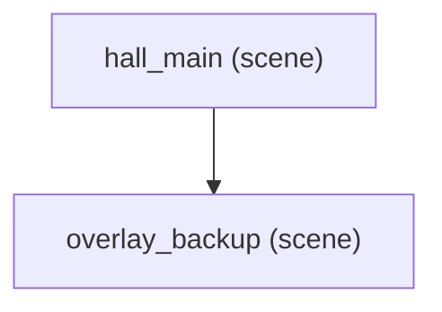

# overlay_backup.tscn

## Purpose
The Backup save sheet reached from the Menu: export the run as a file or a copied code, or load one back (two taps to replace the guild), and Back. See [[overlay_backup]].

## Parent scenes
- **Placed in editor:** [[hall_main (scene)]] at node `OverlayBackup`. Shown by [[hall_main#_refresh_overlays]] (`hall_main.gd:1858`).
- No runtime parents.

## Child scenes
- None.

## Node tree
- `OverlayBackup` (Control), script [[overlay_backup]]
  - `%Dim` (PanelContainer): backdrop; `gui_input` -> [[overlay_backup#_on_dim_input]]
  - `Center/Sheet/Col`: layout (summarized)
    - `%SaveFileButton` (Button): `pressed` -> [[overlay_backup#_on_save_file_pressed]]
    - `%CopyCodeButton` (Button): `pressed` -> [[overlay_backup#_on_copy_code_pressed]]
    - `%LoadFileButton`, `%PasteCodeButton` (Button): `pressed` -> [[overlay_backup#_on_import_pressed]]
    - `%BackButton` (Button): `pressed` -> [[hall_main#close_backup]]

## Scripts attached
- Root: [[overlay_backup]]. `setup(hall)` stores the hall and connects the buttons; `refresh()` sets the import button labels.
- Other nodes: none.

## Resources used
- StyleBox `Themes/Styles/dim.tres`
