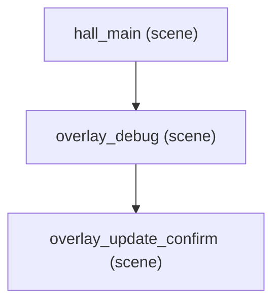

# overlay_debug.tscn

## Purpose
The Debug tools sheet reached from the Menu: a warning with Enable, the Save runs checkbox, Check for update, and the grouped cheats (Time, Wallet, Guild, Run). See [[overlay_debug]].

## Parent scenes
- **Placed in editor:** [[hall_main (scene)]] at node `OverlayDebug`. Shown by [[hall_main#_refresh_overlays]] (`hall_main.gd:1884`).
- No runtime parents.

## Child scenes
- **Placed in editor:** [[overlay_update_confirm (scene)]] at node `UpdateConfirm`
- **Instanced at runtime:** none (the jump, gold and standing buttons are plain `Button`s made by [[overlay_debug#_make_button]]).

## Node tree
- `OverlayDebug` (Control), script [[overlay_debug]]
  - `%Dim` (PanelContainer): backdrop; `gui_input` -> [[overlay_debug#_on_dim_input]]
  - `Center/Sheet/Col`: layout (summarized)
    - `%Note` (Label): warning or "Debug run: not saving", set in [[overlay_debug#refresh]]
    - `%SaveCheckBox` (CheckBox): `toggled` -> [[hall_main#set_save_enabled]]
    - `%UpdateButton` (Button): `pressed` -> [[overlay_debug#_on_update_pressed]]
    - `%EnableButton` (Button): `pressed` -> [[hall_main#enable_debug_tools]]
    - `%Scroll` (ScrollContainer) > `Tools`: shown after Enable
      - `%SkipButton` (Button): -> [[hall_main#debug_skip_day]]
      - `%JumpGrid`, `%WalletGrid` (GridContainer): hold runtime buttons
      - `GuildGrid`: `%HeroButton`, `%ItemButton`, `%HealButton`, `%MaxButton` -> `hall.debug_add_hero`, `debug_add_item`, `debug_heal_everyone`, `debug_max_buildings`
      - `%ResetButton` -> [[hall_main#reset_upgrades]]; `%RerollButton`, `%TutorialButton`, `%IntroButton` -> `hall.debug_reroll_today`, `debug_skip_tutorial`, `debug_replay_intro`
    - `%BackButton` (Button): `pressed` -> [[hall_main#close_debug]]
  - `%UpdateConfirm`: [[overlay_update_confirm (scene)]] instance

## Scripts attached
- Root: [[overlay_debug]]. `setup(hall)` stores the hall, connects everything and sets up `%UpdateConfirm`; `refresh()` toggles the sheets and enables or disables buttons.
- Other nodes: [[overlay_update_confirm]] on `%UpdateConfirm`.

## Resources used
- StyleBox `Themes/Styles/dim.tres`
