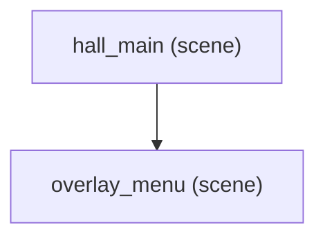

# overlay_menu.tscn

## Purpose
The Menu opened from the header: How to play, Last night's report, Accessibility, Backup save, Debug tools, Abandon run and Close, with the build line under Close. See [[overlay_menu]].

## Parent scenes
- **Placed in editor:** [[hall_main (scene)]] at node `OverlayMenu`. Shown by [[hall_main#_refresh_overlays]] (`hall_main.gd:1856`).
- No runtime parents.

## Child scenes
- None (the `BuildLabel` is a `Label` made in [[overlay_menu#setup]]).

## Node tree
- `OverlayMenu` (Control), script [[overlay_menu]]
  - `%Dim` (PanelContainer): backdrop; `gui_input` -> [[overlay_menu#_on_dim_input]]
  - `Center/Sheet/Col`: layout (summarized)
    - `%HowButton` -> [[hall_main#open_welcome]]; `%ReportButton` -> [[hall_main#open_previous_report]]
    - `%AccessibilityButton` -> [[hall_main#open_accessibility]]; `%BackupButton` -> [[hall_main#open_backup]]; `%DebugButton` -> [[hall_main#open_debug]]
    - `%AbandonButton` (Button): `pressed` -> [[overlay_menu#_on_abandon_pressed]]
    - `%CloseButton` (Button): `pressed` -> [[hall_main#close_menu]]
    - `BuildLabel` (Label): added at runtime after Close

## Scripts attached
- Root: [[overlay_menu]]. `setup(hall)` stores the hall and connects the buttons; `refresh()` updates the report, debug and abandon buttons.
- Other nodes: none.

## Resources used
- StyleBox `Themes/Styles/dim.tres`
