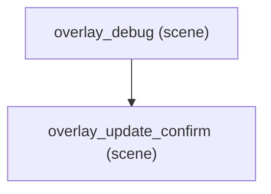

# overlay_update_confirm.tscn

## Purpose
The "A new version is ready" popup: this build and the newest, whether the run is saved, Export save, Cancel and Update. Opened from Debug tools' Check for update. See [[overlay_update_confirm]].

## Parent scenes
- **Placed in editor:** [[overlay_debug (scene)]] at node `UpdateConfirm`. Set up by [[overlay_debug#setup]] (`overlay_debug.gd:95`) and opened by [[overlay_debug#_on_update_checked]] (`overlay_debug.gd:186`).
- No runtime parents.

## Child scenes
- None.

## Node tree
- `OverlayUpdateConfirm` (Control), script [[overlay_update_confirm]]
  - `%Dim` (PanelContainer): backdrop; `gui_input` -> [[overlay_update_confirm#_on_dim_input]]
  - `Margin/Center/Sheet/Col`: layout (summarized)
    - `%Title`, `%Builds`, `%Note` (Label): set in [[overlay_update_confirm#setup]] and [[overlay_update_confirm#open]]
    - `%ExportButton` (Button): `pressed` -> [[overlay_update_confirm#_on_export_pressed]]
    - `Buttons`: `%CancelButton` (Button): `pressed` -> [[overlay_update_confirm#close]]; `%UpdateButton` (Button): `pressed` -> [[overlay_update_confirm#_on_update_pressed]]

## Scripts attached
- Root: [[overlay_update_confirm]]. `setup(hall)` stores the hall and connects the buttons; it has `open(...)` and `close()` instead of `refresh()`.
- Other nodes: none.

## Resources used
- StyleBox `Themes/Styles/dim.tres`
