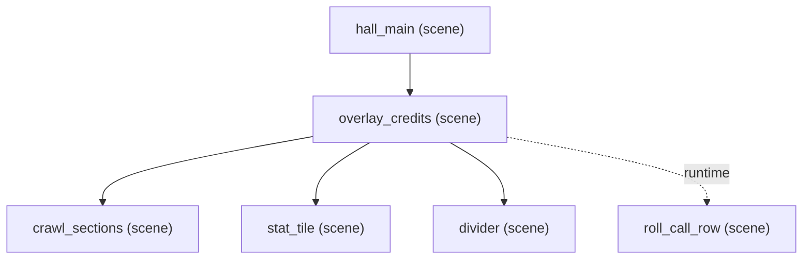

# overlay_credits.tscn

## Purpose
The final battle's credits roll: the story and party scroll up like film credits over a warm (victory) or cold (defeat) background, then the parchment ledger, the team credits and a closing line, with a pinned "Begin Freeplay" / "Found a New Guild" button. See [[overlay_credits]].

## Parent scenes
- **Placed in editor:** [[hall_main (scene)]] at node `OverlayCredits`. Shown by [[hall_main#_refresh_overlays]] (`hall_main.gd:1847`).
- No runtime parents.

## Child scenes
- **Placed in editor:** [[crawl_sections (scene)]] at `Scroll/Margin/Roll/Sections`; [[stat_tile (scene)]] at `DaysTile` (under `Ledger/Col/DaysRow`), `GoldTile`, `QuestsTile`, `HiredTile`, `FallenTile`, `StandingTile`, `SpentTile` (under `Ledger/Col/Grid`), `ItemsTile`, `ServiceTile` (under `Ledger/Col/RecordsGrid`); [[divider (scene)]] at `RecordsDivider` and `RollCallDivider`.
- **Instanced at runtime:** [[roll_call_row (scene)]], created by [[overlay_credits#_show_roll_call]] (`overlay_credits.gd:220`). The team and building labels are plain `Label`s from [[overlay_credits#_make_line]]. A [[crawl_roll]] node is added as a child in [[overlay_credits#setup]].

## Node tree
- `OverlayCredits` (Control), script [[overlay_credits]]
  - `%Bg` (ColorRect): mood background, set in [[overlay_credits#refresh]]
  - `%Scroll` (ScrollContainer) > `Margin/Roll` (VBoxContainer): the roll
    - `%TopSpace` (Control): blank space above the title
    - `%Sections`: [[crawl_sections (scene)]] (title, story, party)
    - `Ledger/Col`: parchment ledger (summarized): the stat tiles above, `%Buildings` (VBoxContainer, runtime labels), `%RollCall` (VBoxContainer, runtime rows), `%Empty` (Label)
    - `%TeamHeading` (Label), `%Team` (VBoxContainer): team credits, filled at runtime
    - `%End`, `%EndSub` (Label): closing line
    - `%BottomSpace` (Control)
  - `%Footer` (MarginContainer) > `%ActionButton` (Button): `pressed` -> [[overlay_credits#_on_action_pressed]]

## Scripts attached
- Root: [[overlay_credits]]. `setup(hall)` connects the button and adds the [[crawl_roll]]; `refresh()` builds the roll once.
- Other nodes: [[crawl_sections]] on `%Sections`; [[stat_tile]] on the tiles.

## Resources used
- Texture `Sprites/UI Textures/connector.png`; team credits `Data/credits.tres` (loaded by the script)
