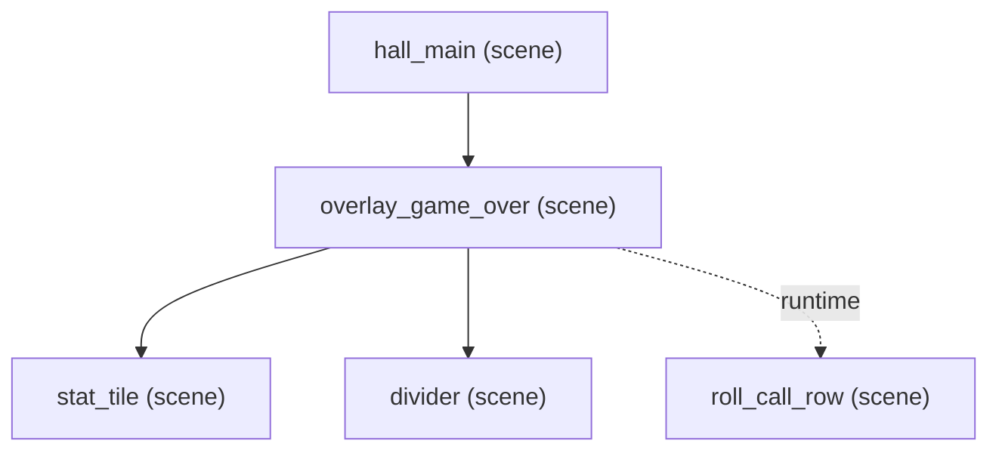

# overlay_game_over.tscn

## Purpose
The Game Over ledger the player sees when the guild has no living hero and no affordable recruit: a Days tile, a grid of the run's numbers (with the Bone Drake result), the roll call, and "Found a New Guild". See [[overlay_game_over]].

## Parent scenes
- **Placed in editor:** [[hall_main (scene)]] at node `OverlayGameOver`. Shown by [[hall_main#_refresh_overlays]] (`hall_main.gd:1852`).
- No runtime parents.

## Child scenes
- **Placed in editor:** [[stat_tile (scene)]] at `Layout/Scroll/Margin/Ledger/Col/DaysRow/DaysTile` and, under `.../Col/Grid`, `GoldTile`, `QuestsTile`, `HiredTile`, `FallenTile`, `StandingTile`, `DrakeTile`; [[divider (scene)]] at `.../Col/Divider`.
- **Instanced at runtime:** [[roll_call_row (scene)]], created by [[overlay_game_over#_show_roll_call]] (`overlay_game_over.gd:92`).

## Node tree
- `OverlayGameOver` (Control), script [[overlay_game_over]]
  - `Bg` (TextureRect): wood background
  - `Layout` (VBoxContainer): layout (summarized)
    - `HeadMargin/Head`: `Title`, `Sub` labels
    - `%Scroll` (ScrollContainer) > `Margin/Ledger/Col`: the parchment ledger
      - `%DaysTile`, `%GoldTile`, `%QuestsTile`, `%HiredTile`, `%FallenTile`, `%StandingTile`, `%DrakeTile`: [[stat_tile (scene)]] instances, filled in [[overlay_game_over#_show_tiles]]
      - `%RollCall` (VBoxContainer): holds the runtime roll-call rows
      - `%Empty` (Label): "No hero ever joined this guild."
    - `Footer/Col/%NewRunButton` (Button): `pressed` -> [[hall_main#start_new_run]]

## Scripts attached
- Root: [[overlay_game_over]]. `setup(hall)` connects the button; `refresh()` builds the ledger once.
- Other nodes: [[stat_tile]] on each tile.

## Resources used
- Textures `Sprites/UI Textures/wood.png`, `Sprites/UI Textures/connector.png`
