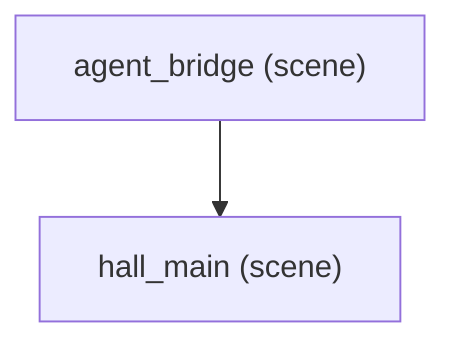

# agent_bridge.tscn

## Purpose
Top-level run scene of the AI playtest bridge (`tools/playtest/`). It holds the real hall as a child, and [[agent_bridge]] answers file commands (`cmd.json` / `resp.json`) that drive it. Excluded from exports. System: [[Playtest Bridge]].

## Parent scenes
- *(Top-level run scene: none. It lives under `Scenes/Playtest/`.)*

## Child scenes
- **Placed in editor:** [[hall_main (scene)]] at node `HallMain`
- **Instanced at runtime:** none

## Node tree
- `AgentBridge` (Control), script [[agent_bridge]]
  - `HallMain`: instance of [[hall_main (scene)]] (read as `_hall`; it is a child, not the root, so it never saves)

## Scripts attached
- Root: [[agent_bridge]]. No `setup(hall)`; it polls the bridge directory in `_process`.
- Other nodes: none

## Resources used
- None beyond the script and `hall_main.tscn`.
