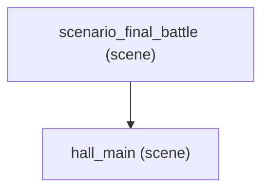

# scenario_final_battle.tscn

## Purpose
Playtest scenario: starts the hall on day 50 (the final battle) with 2000 gold, standing 60, four living heroes (injuries 0, 0, 0, 1) and one fallen hero, no welcome card, and the toast "Day 50. The final battle is here!". System: [[Playtest Bridge]].

## Parent scenes
- *(Top-level run scene: none. It lives under `Scenes/Playtest/` and is run directly with F6.)*

## Child scenes
- **Placed in editor:** [[hall_main (scene)]] at node `HallMain`
- **Instanced at runtime:** none

## Node tree
- `ScenarioFinalBattle` (Control, full rect), script [[playtest_scenario]]
  - `HallMain`: instance of [[hall_main (scene)]]

## Scripts attached
- Root: [[playtest_scenario]]. start_day 50, start_standing 60, start_gold 2000, member_injuries [0, 0, 0, 1], fallen_members 1, show_welcome false, intro_toast set.
- Other nodes: none

## Resources used
- None beyond the two ext_resources (the script and `hall_main.tscn`).
