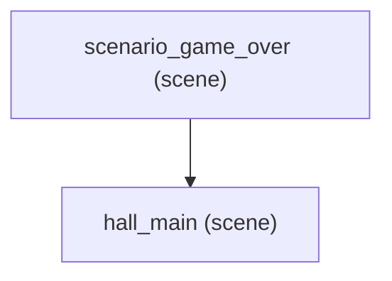

# scenario_game_over.tscn

## Purpose
Playtest scenario: starts the hall on day 6 with 50 gold, standing 3, no living heroes and two fallen ones, no welcome card. Used to reach the Game Over ledger and its roll call. System: [[Playtest Bridge]].

## Parent scenes
- *(Top-level run scene: none. It lives under `Scenes/Playtest/` and is run directly with F6.)*

## Child scenes
- **Placed in editor:** [[hall_main (scene)]] at node `HallMain`
- **Instanced at runtime:** none

## Node tree
- `ScenarioGameOver` (Control, full rect), script [[playtest_scenario]]
  - `HallMain`: instance of [[hall_main (scene)]]

## Scripts attached
- Root: [[playtest_scenario]]. start_day 6, start_standing 3, start_gold 50, member_injuries [], fallen_members 2, show_welcome false.
- Other nodes: none

## Resources used
- None beyond the two ext_resources (the script and `hall_main.tscn`).
