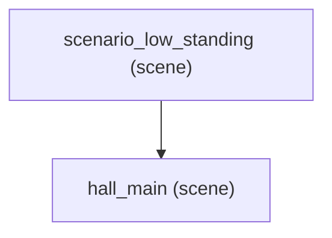

# scenario_low_standing.tscn

## Purpose
Playtest scenario: starts the hall on day 8 at rock-bottom standing (-10, so nobody new shows up For Hire) with 120 gold and two hurt heroes (injuries 2, 3); toast "Standing is at rock bottom. Two hurt adventurers left.". System: [[Playtest Bridge]].

## Parent scenes
- *(Top-level run scene: none. It lives under `Scenes/Playtest/` and is run directly with F6.)*

## Child scenes
- **Placed in editor:** [[hall_main (scene)]] at node `HallMain`
- **Instanced at runtime:** none

## Node tree
- `ScenarioLowStanding` (Control, full rect), script [[playtest_scenario]]
  - `HallMain`: instance of [[hall_main (scene)]]

## Scripts attached
- Root: [[playtest_scenario]]. These are the script defaults: start_day 8, start_standing -10, start_gold 120, member_injuries [2, 3]; intro_toast set.
- Other nodes: none

## Resources used
- None beyond the two ext_resources (the script and `hall_main.tscn`).
