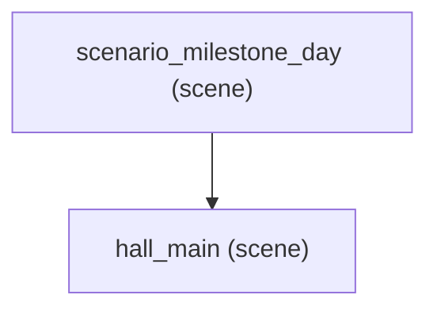

# scenario_milestone_day.tscn

## Purpose
Playtest scenario: starts the hall on day 10 (the Bone Drake boss quest) with 400 gold, standing 5 and two hurt heroes (injuries 1, 2); toast "Day 10. The Bone Drake is attacking!". System: [[Playtest Bridge]].

## Parent scenes
- *(Top-level run scene: none. It lives under `Scenes/Playtest/` and is run directly with F6.)*

## Child scenes
- **Placed in editor:** [[hall_main (scene)]] at node `HallMain`
- **Instanced at runtime:** none

## Node tree
- `ScenarioMilestoneDay` (Control, full rect), script [[playtest_scenario]]
  - `HallMain`: instance of [[hall_main (scene)]]

## Scripts attached
- Root: [[playtest_scenario]]. start_day 10, start_standing 5, start_gold 400, member_injuries [1, 2], intro_toast set.
- Other nodes: none

## Resources used
- None beyond the two ext_resources (the script and `hall_main.tscn`).
