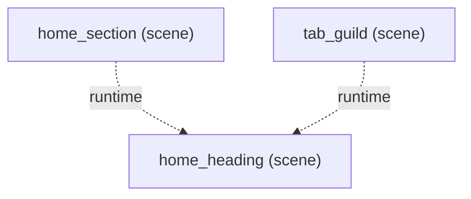

# home_heading.tscn

## Purpose
A small caps heading label ("PICK A HERO", "IN A BED", "NEEDS CARE", "FALLEN") between groups of rows. It has no script.

## Parent scenes
- **Placed in editor:** none.
- **Instanced at runtime:** by [[home_section#_add_heading]] (`home_section.gd:73`), which hands the preloaded scene to `HallStyle.add_row` and sets `.text`. The parent scene is [[home_section (scene)]]. Also by [[tab_guild#_show_roster]] (`tab_guild.gd:159`), where it heads the fallen heroes. The parent scene there is [[tab_guild (scene)]].

## Child scenes
- **Placed in editor:** none.
- **Instanced at runtime:** none.

## Node tree
- `HomeHeading` (Label, `CapsLabel` variation, uppercase, autowrap): the whole scene.

## Scripts attached
- None.

## Resources used
- None.
