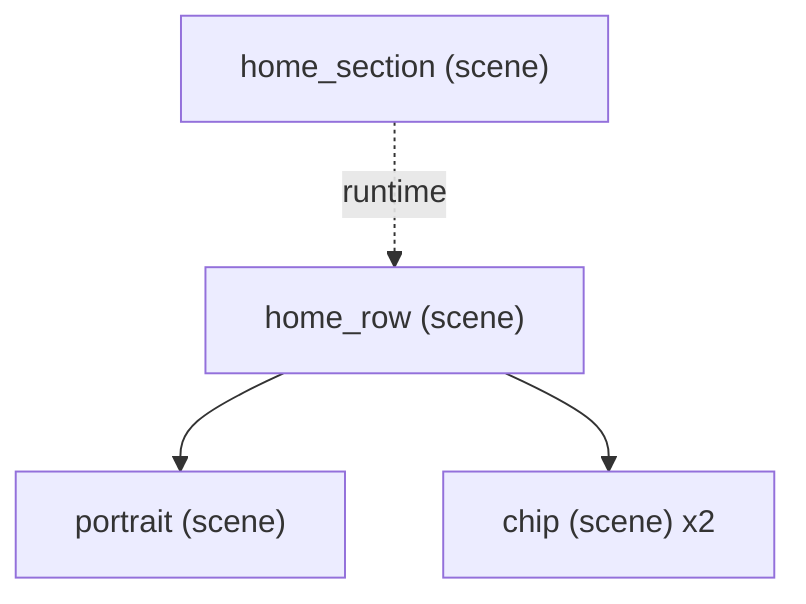

# home_row.tscn

## Purpose
One hero inside a Training Yard or Hospital card: portrait, name, role, health and task chips, a note line, two buttons and a four-button stat picker. [[home_row]] shows or hides parts depending on which `show_*` function is called. Belongs to [[Night - Training Hospital Revive]].

## Parent scenes
- **Placed in editor:** none.
- **Instanced at runtime:** by [[home_section#_add_row]] (`home_section.gd:77`), which hands the preloaded scene to `HallStyle.add_row`. The parent scene is [[home_section (scene)]].

## Child scenes
- **Placed in editor:** [[portrait (scene)]] at `Col/Row/Portrait`; [[chip (scene)]] at `Col/Row/Info/Chips/HealthChip` and `Col/Row/Info/Chips/TaskChip`.
- **Instanced at runtime:** none.

## Node tree
- `HomeRow` (PanelContainer), script [[home_row]]
  - `Col/Row` (HBoxContainer): layout
    - `%Portrait` ([[portrait]])
    - `Info`: `Top` with `%Name`, `%Role`; `Chips` with `%HealthChip`, `%TaskChip` ([[chip]]); `%Note` (Label)
    - `%SideButton` (Button), `%MainButton` (Button): wired in [[home_row#_set_button]]
  - `%StatPicker` (HBoxContainer): four buttons `Pow`, `Def`, `Wis`, `Slz`, wired in [[home_row#_show_stat_picker]]

## Scripts attached
- Root: [[home_row]]. No `setup`; the caller picks one of the `show_*` functions.
- Other nodes: [[portrait]], [[chip]].

## Resources used
- None beyond the child scenes.
