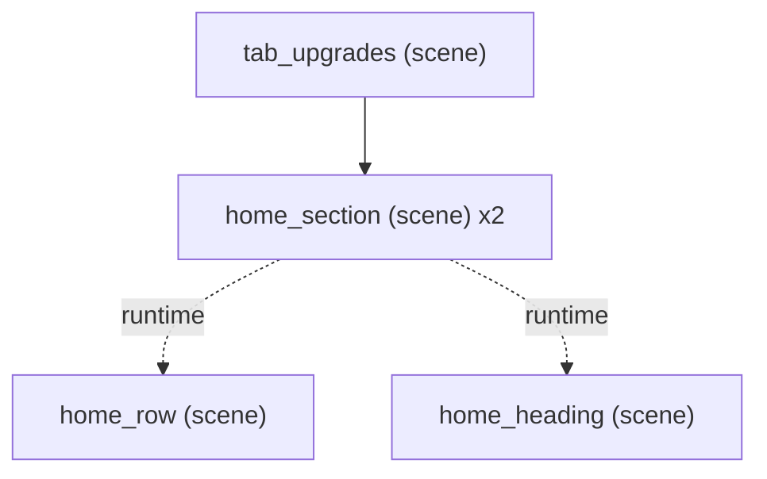

# home_section.tscn

## Purpose
A pinned card for one facility on the Upgrades tab's Tonight half: a tag with the building's icon, its name and level, a summary line, a list of heroes, and (Training Yard only) an Add / Done picking button. Belongs to [[Night - Training Hospital Revive]].

## Parent scenes
- **Placed in editor:** [[tab_upgrades (scene)]] at `FolderMargin/Folder/Scroll/Margin/Col/Tonight/TrainingSection` and `.../Tonight/HospitalSection`.
- **Instanced at runtime:** none.

## Child scenes
- **Placed in editor:** none.
- **Instanced at runtime:** [[home_row (scene)]], created by [[home_section#_add_row]] (`home_section.gd:77`); [[home_heading (scene)]], created by [[home_section#_add_heading]] (`home_section.gd:73`).

## Node tree
- `HomeSection` (PanelContainer), script [[home_section]]
  - `Col/Top`: `%TagBox` (PanelContainer) with `%Tag` (Label), `%TagIcon` (TextureRect); `Names` with `%Name`, `%Level`, `%Summary`
  - `%List` (VBoxContainer): holds the runtime rows and headings
  - `%Empty` (Label): empty-state note
  - `%AddButton` (Button): `pressed` goes to `hall.toggle_training_picker` (connected in [[home_section#setup]])
  - `Nails`: two decorative corner nails

## Scripts attached
- Root: [[home_section]]. `setup(hall, building)` and `refresh()`.
- Other nodes: none.

## Resources used
- Textures `Sprites/UI Textures/pin.png`, `Sprites/Hall Icons/target.tres`.
