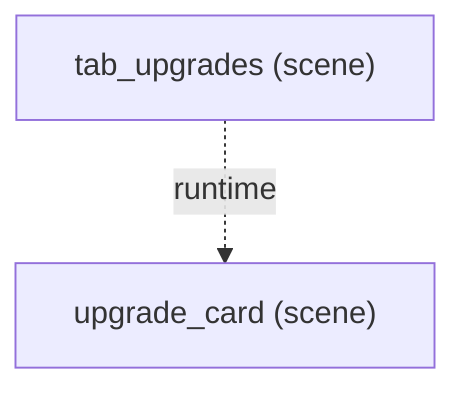

# upgrade_card.tscn

## Purpose
One building on the Upgrades tab's Build half, drawn as a plan: icon, name, five level diamonds, what it does now and next, and the Build button with a status line. Belongs to [[Economy and Wallet]].

## Parent scenes
- **Placed in editor:** none.
- **Instanced at runtime:** by [[tab_upgrades#_show_building_cards]] (`tab_upgrades.gd:114`), which hands the preloaded scene to `HallStyle.add_row`. The parent scene is [[tab_upgrades (scene)]].

## Child scenes
- **Placed in editor:** none.
- **Instanced at runtime:** none.

## Node tree
- `UpgradeCard` (PanelContainer), script [[upgrade_card]]
  - `Col/Top`: `IconBox/%Icon` (TextureRect); `Info` with `%Name`, `LevelRow/%Level` and `%Pips` (HBoxContainer of `Pip0` to `Pip4` diamonds)
  - `Col/Dash`: divider art
  - `%Now`, `%Next` (Labels): current and next effect
  - `Col/Bottom`: `%Status` (Label), `%UpgradeButton` (Button): `pressed` goes to `hall.upgrade_building` (connected in [[upgrade_card#setup]])
  - `Nails`: four decorative corner nails

## Scripts attached
- Root: [[upgrade_card]]. `setup(hall, building)`.
- Other nodes: none.

## Resources used
- Textures `Sprites/Hall Icons/swords.tres`, `diamond.tres`, `coins.tres`; `Sprites/UI Textures/dash.png`, `pin.png`.
