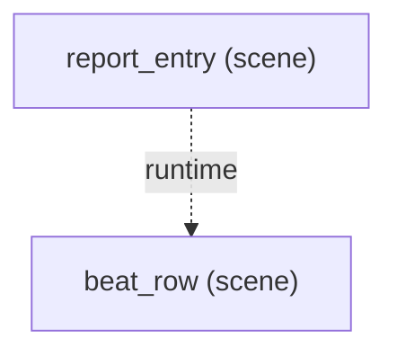

# beat_row.tscn

## Purpose
One line of a quest's story inside a Day Report letter: a small icon and a rich-text line.

## Parent scenes
- **Placed in editor:** none.
- **Instanced at runtime:** by [[report_entry#_build_story_beats]] (`report_entry.gd:332`), which hands the preloaded scene to `HallStyle.add_row`. The parent scene is [[report_entry (scene)]].

## Child scenes
- **Placed in editor:** none.
- **Instanced at runtime:** none.

## Node tree
- `BeatRow` (HBoxContainer), script [[beat_row]]
  - `Icon` (TextureRect): found with `$Icon`, not a `%` node
  - `Text` (RichTextLabel): found with `$Text`, not a `%` node

## Scripts attached
- Root: [[beat_row]]. `setup(icon_name, icon_tint, bbcode)`.
- Other nodes: none.

## Resources used
- Texture `Sprites/Hall Icons/scroll.tres`.
