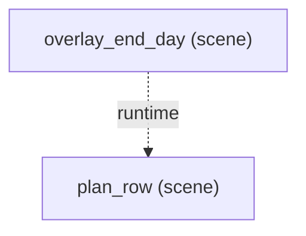

# plan_row.tscn

## Purpose
One party going out tonight, listed on the End Day check: type seal, quest title, party names and the odds.

## Parent scenes
- **Placed in editor:** none.
- **Instanced at runtime:** by [[overlay_end_day#_show_tonights_plan]] (`overlay_end_day.gd:77`), which hands the preloaded scene to `HallStyle.add_row`. The parent scene is [[overlay_end_day (scene)]].

## Child scenes
- **Placed in editor:** none.
- **Instanced at runtime:** none.

## Node tree
- `PlanRow` (HBoxContainer), script [[plan_row]]
  - `%TagBox` (PanelContainer) with `%Tag` (Label), `%TagIcon` (TextureRect): the type seal
  - `Info`: `%Title`, `%PartyNames` (Labels)
  - `%Odds` (Label): the success chance

## Scripts attached
- Root: [[plan_row]]. `setup(hall, entry)`.
- Other nodes: none.

## Resources used
- Texture `Sprites/Hall Icons/gate.tres`.
