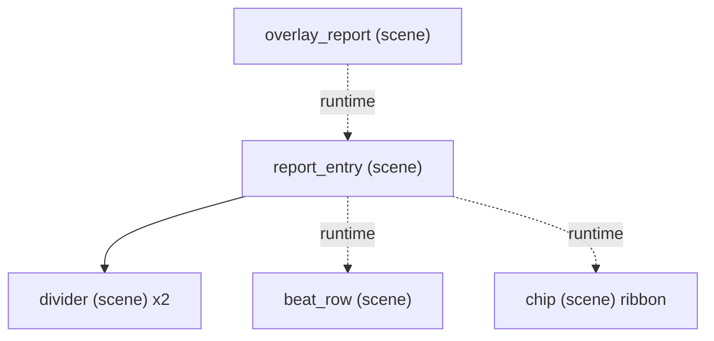

# report_entry.tscn

## Purpose
One quest in the Day Report, drawn as a letter home: head with type seal, title and From line; a Success / Failed stamp; Hurt / Died / Found / Standing tags; the story beats and a closing line. Everyday letters fold to just the head. Belongs to [[Quest Resolution and Injuries]].

## Parent scenes
- **Placed in editor:** none.
- **Instanced at runtime:** by [[overlay_report#_show_entries]] (`overlay_report.gd:286`), which hands the preloaded scene to `HallStyle.add_row`. The parent scene is [[overlay_report (scene)]].

## Child scenes
- **Placed in editor:** [[divider (scene)]] at `Col/Divider` and `Col/Divider2`.
- **Instanced at runtime:** [[beat_row (scene)]] per story line, created by [[report_entry#_build_story_beats]] (`report_entry.gd:332`); a [[chip (scene)]] story ribbon, created by [[report_entry#_show_story_look]] (`report_entry.gd:202`).

## Node tree
- `ReportEntry` (PanelContainer), script [[report_entry]]
  - `Col`: layout
    - `Head`: `%TypeSeal` with `%TypeTag`, `%TypeIcon`; `HeadText` with `%Title`, `%From`; `%StampRoom` (Control keeping room for the stamp)
    - `Tags`: `%HurtTag` (`%HurtText`), `%DiedTag` (`DiedRow/%DiedText`), `%FoundTag` (`%FoundText`), `%StandingTag` (`%StandingText`)
    - `Divider`, `%Beats` (VBoxContainer holding the runtime beat rows), `Divider2`, `%Closing` (Label)
  - `Decor/%Stamp` (PanelContainer) with `%StampText`: the Success / Failed stamp

## Scripts attached
- Root: [[report_entry]]. `setup(result, start_folded)`, `reveal(delay)`, `set_folded()`.
- Other nodes: none.

## Resources used
- Textures `Sprites/Hall Icons/skull.tres`, `Sprites/Hall Icons/flag.tres`.
