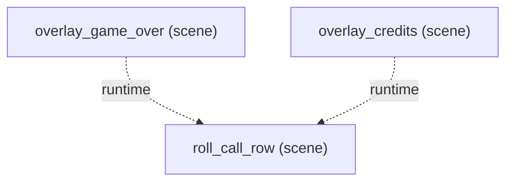

# roll_call_row.tscn

## Purpose
One hero on the roll call of the Game Over ledger and the credits: a fate icon, name and role, and what became of them. Belongs to [[Run End]].

## Parent scenes
- **Placed in editor:** none.
- **Instanced at runtime:** by [[overlay_game_over#_show_roll_call]] (`overlay_game_over.gd:92`) and [[overlay_credits#_show_roll_call]] (`overlay_credits.gd:220`), each handing the preloaded scene to `HallStyle.add_row`. The parent scenes are [[overlay_game_over (scene)]] and [[overlay_credits (scene)]].

## Child scenes
- **Placed in editor:** none.
- **Instanced at runtime:** none.

## Node tree
- `RollCallRow` (HBoxContainer), script [[roll_call_row]]
  - `%Icon` (TextureRect): skull, back arrow or heart
  - `Text`: `%Name`, `%Fate` (Labels)

## Scripts attached
- Root: [[roll_call_row]]. `setup(character, was_released)`.
- Other nodes: none.

## Resources used
- Texture `Sprites/Hall Icons/skull.tres`.
