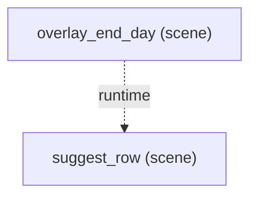

# suggest_row.tscn

## Purpose
An affordable building upgrade offered on the End Day check: type seal, name and next level, effect, and a green buy button with the gold cost. Belongs to [[Economy and Wallet]].

## Parent scenes
- **Placed in editor:** none.
- **Instanced at runtime:** by [[overlay_end_day#_show_upgrade_suggestions]] (`overlay_end_day.gd:94`), which hands the preloaded scene to `HallStyle.add_row`. The parent scene is [[overlay_end_day (scene)]].

## Child scenes
- **Placed in editor:** none.
- **Instanced at runtime:** none.

## Node tree
- `SuggestRow` (HBoxContainer), script [[suggest_row]]
  - `%TagBox` (PanelContainer) with `%Tag`, `%TagIcon`: the building seal
  - `Info`: `%Name`, `%Effect` (Labels)
  - `%BuyButton` (Button): `pressed` goes to `hall.upgrade_building` (connected in [[suggest_row#setup]])

## Scripts attached
- Root: [[suggest_row]]. `setup(hall, building)`.
- Other nodes: none.

## Resources used
- Texture `Sprites/Hall Icons/swords.tres`.
