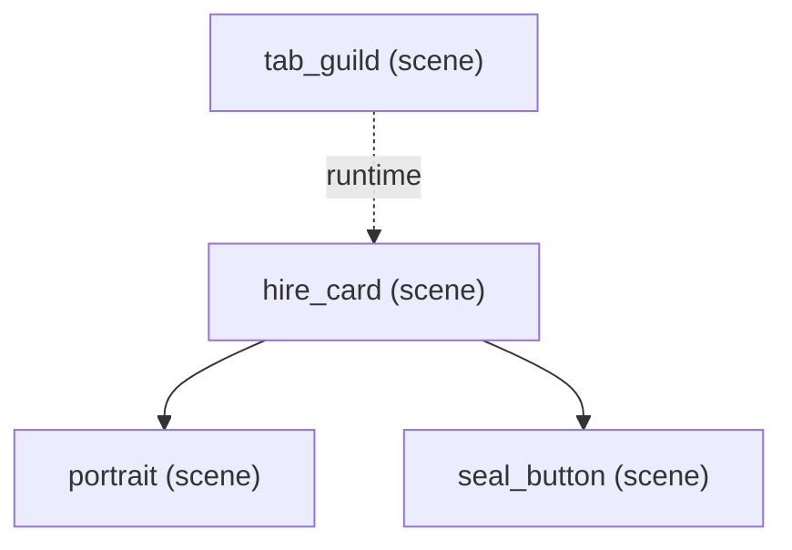

# hire_card.tscn

## Purpose
One For Hire applicant, drawn as a letter of introduction: portrait, one title line (name and role, "Juan the Priest"), five stat boxes with a total, a wax-sealed Hire button, and the full backstory with a drop cap. Belongs to [[Hiring Characters]].

## Parent scenes
- **Placed in editor:** none.
- **Instanced at runtime:** by [[tab_guild#_show_for_hire]] (`tab_guild.gd:184`), which hands the preloaded scene to `HallStyle.add_row`. The parent scene is [[tab_guild (scene)]].

## Child scenes
- **Placed in editor:** [[portrait (scene)]] at `Col/Top/Portrait`; [[seal_button (scene)]] at `Col/Buttons/HireButton`.
- **Instanced at runtime:** none (the stat columns are `duplicate()`s of the scene's `StatTemplate`, made in [[hire_card#_ready]]).

## Node tree
- `HireCard` (PanelContainer), script [[hire_card]]
  - `Col` (VBoxContainer): layout
    - `Top`: `%Portrait` ([[portrait]]) and `Fields` with `%Name` (the name-and-role title label)
    - `%Stats` (HBoxContainer): one `StatTemplate` column (`Caps` label, `Box/Value`), duplicated at runtime to 5
    - `TotalRow`: `TotalStack/Total` is `%Total` (Label) on the ink circle
    - `Buttons/%HireButton` ([[seal_button (scene)]]): `pressed` goes to [[hire_card#_on_hire_pressed]]
    - `Story`: `%DropCap`, `%Blurb` (Labels)

## Scripts attached
- Root: [[hire_card]]. `setup(hall, recruit, letter_index)`.
- Other nodes: [[portrait]] on `%Portrait`.

## Resources used
- Textures `Sprites/UI Textures/dash.png`, `Sprites/UI Textures/ink_circle.png`.
