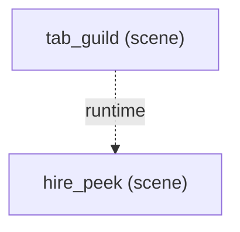

# hire_peek.tscn

## Purpose
The edge of the next applicant's letter peeking out under the top [[hire_card (scene)]] in the For Hire stack: a short paper card with the name and role, right-aligned. Tapping it brings that applicant to the top. Belongs to [[Hiring Characters]].

## Parent scenes
- **Placed in editor:** none.
- **Instanced at runtime:** by [[tab_guild#_show_for_hire]] (`tab_guild.gd:195`), which hands the preloaded scene to `HallStyle.add_row` (the `_letter_stack`). The parent scene is [[tab_guild (scene)]]. [[tab_guild#_show_for_hire]] tilts it, sets the `Text` label to "name · role" and connects `pressed` to `_bring_to_top`.

## Child scenes
- **Placed in editor:** none.
- **Instanced at runtime:** none.

## Node tree
- `HirePeek` (PanelContainer, `PaperCard` variation), script [[tap_panel]] (no script of its own)
  - `Text` (Label, `TitleLabel` variation): not a `%` node; the parent finds it with `get_node("Text")`

## Scripts attached
- Root: [[tap_panel]] (provides the `pressed` signal).
- Other nodes: none.

## Resources used
- None.
