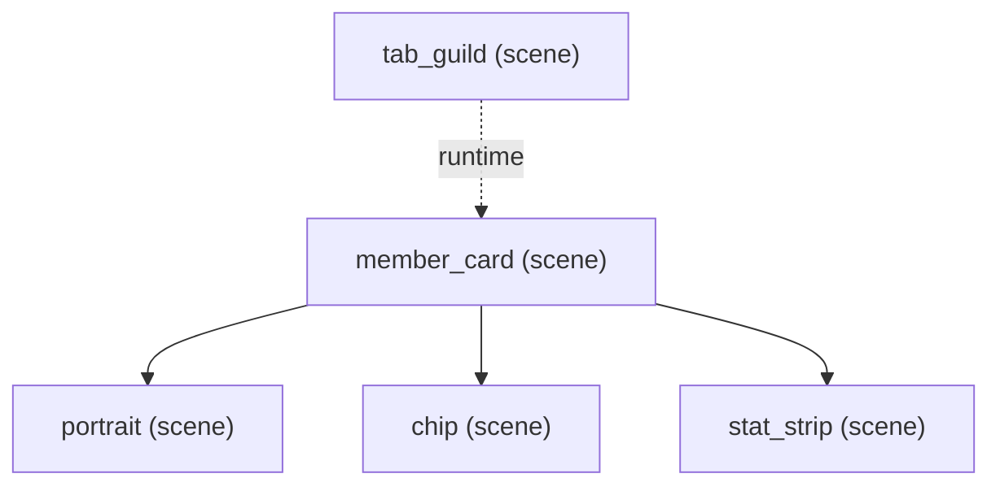

# member_card.tscn

## Purpose
One adventurer in the Guild tab's roster: portrait, name, role, task chip, health and top two stats, a status word and a caret. Tapping opens the hero's page.

## Parent scenes
- **Placed in editor:** none.
- **Instanced at runtime:** by [[tab_guild#_show_roster]] (`tab_guild.gd:151` and `tab_guild.gd:163`), which hands the preloaded scene to `HallStyle.add_row`. The parent scene is [[tab_guild (scene)]].

## Child scenes
- **Placed in editor:** [[portrait (scene)]] at `Row/Portrait`; [[chip (scene)]] at `Row/Info/Mid/TaskChip`; [[stat_strip (scene)]] at `Row/Info/Stats`.
- **Instanced at runtime:** none.

## Node tree
- `MemberCard` (PanelContainer), script [[member_card]]
  - `Row` (HBoxContainer): layout
    - `%Portrait` ([[portrait]])
    - `Info`: `Top` with `%Name`, `%Role`; `Mid` with `%TaskChip` ([[chip]]); `%Stats` ([[stat_strip]])
    - `%Status` (Label): set in [[member_card#_show_status]]
    - `ChevronBox/%Chevron` (Label): caret, turned in [[member_card#_ready]]

## Scripts attached
- Root: [[member_card]]. `setup(hall, character)`.
- Other nodes: [[portrait]], [[chip]], [[stat_strip]] on the placed children.

## Resources used
- None beyond the child scenes.
