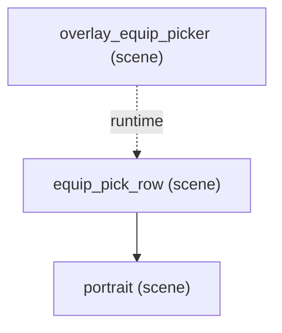

# equip_pick_row.tscn

## Purpose
One hero in the Equip picker: portrait, name and role, slot usage, the stat change the item would make, and an Equip / Swap button. Belongs to [[Items and Shop]].

## Parent scenes
- **Placed in editor:** none.
- **Instanced at runtime:** by [[overlay_equip_picker#refresh]] (`overlay_equip_picker.gd:80`), which hands the preloaded scene to `HallStyle.add_row`. The parent scene is [[overlay_equip_picker (scene)]].

## Child scenes
- **Placed in editor:** [[portrait (scene)]] at `Row/Portrait`.
- **Instanced at runtime:** none.

## Node tree
- `EquipPickRow` (PanelContainer), script [[equip_pick_row]]
  - `Row` (HBoxContainer): layout
    - `%Portrait` ([[portrait]])
    - `Text`: `%HeroName`, `%Slots`, `%Change` (Labels)
    - `%ActionButton` (Button): `pressed` goes to the callable passed to [[equip_pick_row#setup]]

## Scripts attached
- Root: [[equip_pick_row]]. `setup(character, change, button_text, button_kind, on_press)`.
- Other nodes: [[portrait]].

## Resources used
- None beyond the child scene.
