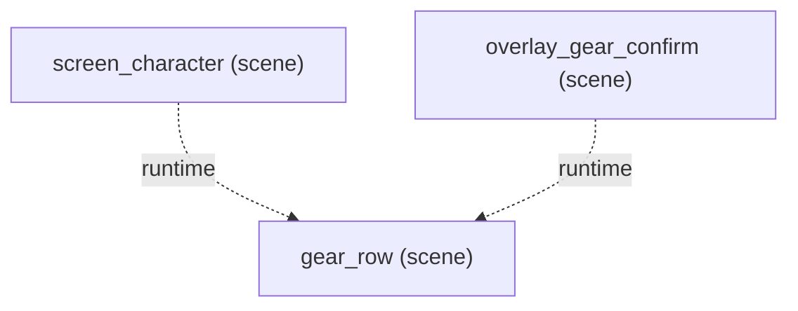

# gear_row.tscn

## Purpose
One line of gear: a rarity-coloured seal (item icon or "+"), the item's name and effect, and one action button. Used for worn items, empty slots and the pick list on a hero's page, and for worn items in the swap sheet. Belongs to [[Items and Shop]].

## Parent scenes
- **Placed in editor:** none.
- **Instanced at runtime:** by [[screen_character#_show_gear]] (`screen_character.gd:268`, `279`, `298`) and by [[overlay_gear_confirm#_show_swap]] (`overlay_gear_confirm.gd:137`), each handing the preloaded scene to `HallStyle.add_row`. The parent scenes are [[screen_character (scene)]] and [[overlay_gear_confirm (scene)]].

## Child scenes
- **Placed in editor:** none.
- **Instanced at runtime:** none.

## Node tree
- `GearRow` (PanelContainer), script [[gear_row]]
  - `Row` (HBoxContainer): layout
    - `%Tag` (PanelContainer) with `%TagText` (Label), `%TagIcon` (TextureRect): the seal
    - `Info`: `%ItemName`, `%Effect` (Labels)
    - `%ActionButton` (Button): hidden when no text; wired in [[gear_row#_set_button]]

## Scripts attached
- Root: [[gear_row]]. `setup(...)` and `setup_empty(...)`.
- Other nodes: none.

## Resources used
- Texture `Sprites/Item Icons/sword_icon.png` (placeholder icon in the authored scene).
