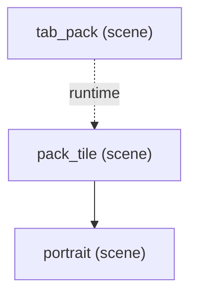

# pack_tile.tscn

## Purpose
One owned item on the Pack grid, drawn as a goods tag: seal, name, stat bonus, and either a wearer ribbon with a portrait medallion or a "Spare" note. A Button, so tapping picks the item. Belongs to [[Items and Shop]].

## Parent scenes
- **Placed in editor:** none.
- **Instanced at runtime:** by [[tab_pack#_show_grid]] (`tab_pack.gd:143`), which hands the preloaded scene to `HallStyle.add_row`. The parent scene is [[tab_pack (scene)]].

## Child scenes
- **Placed in editor:** [[portrait (scene)]] at `Medallion`.
- **Instanced at runtime:** none.

## Node tree
- `PackTile` (Button), script [[pack_tile]]
  - `Col` (VBoxContainer): layout
    - `%Tag` (PanelContainer) with `%TagText`, `%TagIcon`: the seal
    - `%ItemName`, `%Bonus` (Labels)
    - `%Ribbon` (PanelContainer) with `%RibbonText`: "On <hero>"
    - `%SpareNote` (Label)
  - `%Medallion` ([[portrait]]): the wearer, pinned to the corner

## Scripts attached
- Root: [[pack_tile]]. `setup(item, is_selected, on_pick)`.
- Other nodes: [[portrait]] on `%Medallion`.

## Resources used
- Texture `Sprites/Item Icons/orb_icon.png` (placeholder icon in the authored scene); theme variations `GoodsTag` / `GoodsTagSelected` from `Themes/hall_theme.tres` (set in [[pack_tile#setup]]).
