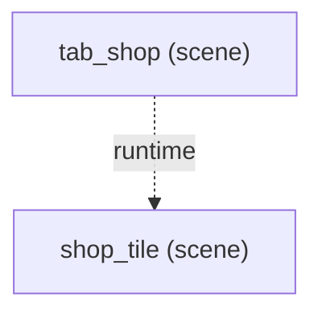

# shop_tile.tscn

## Purpose
One item for sale on the Shop's goods grid, drawn as a parchment price tag: seal, name, price, and a SOLD stamp once bought. A Button, so tapping picks the item. Belongs to [[Items and Shop]].

## Parent scenes
- **Placed in editor:** none.
- **Instanced at runtime:** by [[tab_shop#_show_goods]] (`tab_shop.gd:91`), which hands the preloaded scene to `HallStyle.add_row`. The parent scene is [[tab_shop (scene)]].

## Child scenes
- **Placed in editor:** none.
- **Instanced at runtime:** none.

## Node tree
- `ShopTile` (Button), script [[shop_tile]]
  - `Col` (VBoxContainer): layout
    - `%Tag` (PanelContainer) with `%TagText`, `%TagIcon`: the seal
    - `%ItemName` (Label)
    - `%Price` (HBoxContainer) with `%PriceText` (Label) and a coin
    - `%SoldNote` (Label): "Back tomorrow"
  - `%SoldStamp` (PanelContainer): shown for a sold item

## Scripts attached
- Root: [[shop_tile]]. `setup(good, is_selected, on_pick)`.
- Other nodes: none.

## Resources used
- Textures `Sprites/UI Textures/coin.png`, `tag_hole.png`, `Sprites/Item Icons/sword_icon.png`; theme variations `GoodsTag` / `GoodsTagSelected`.
