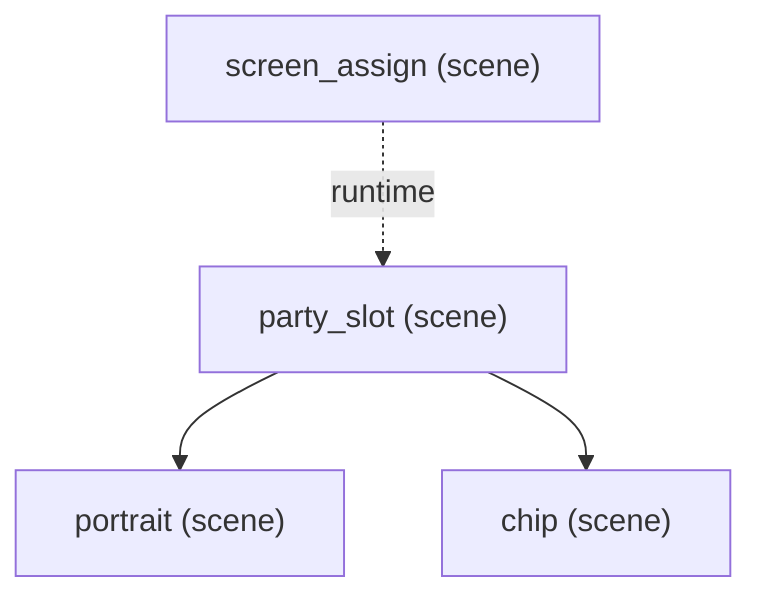

# party_slot.tscn

## Purpose
One seat in Assign Party's party: a filled card (portrait, name, role, favored-stat chip) or a compact empty seat. Belongs to [[Party Drafting and Assignment]].

## Parent scenes
- **Placed in editor:** none.
- **Instanced at runtime:** by [[screen_assign#_show_party]] (`screen_assign.gd:248`), which hands the preloaded scene to `HallStyle.add_row` (into the party list or the empty-seats row). The parent scene is [[screen_assign (scene)]].

## Child scenes
- **Placed in editor:** [[portrait (scene)]] at `Row/Portrait`; [[chip (scene)]] at `Row/Info/FavChip`.
- **Instanced at runtime:** none.

## Node tree
- `PartySlot` (PanelContainer), script [[party_slot]]
  - `Row` (HBoxContainer): layout
    - `%Portrait` ([[portrait]]): shown only for a filled seat
    - `Info` (VBoxContainer): `%SlotName`, `%SlotHint` (Labels), `%FavChip` ([[chip]])

## Scripts attached
- Root: [[party_slot]]. `setup(hall, entry, seated, on_empty_pressed)`.
- Other nodes: [[portrait]] on `%Portrait`, [[chip]] on `%FavChip`.

## Resources used
- None beyond the two child scenes.
