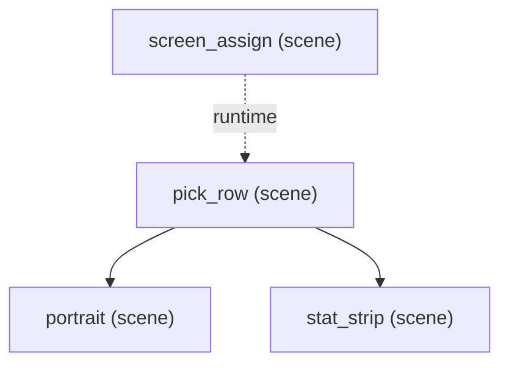

# pick_row.tscn

## Purpose
One adventurer in Assign Party's picker: portrait, name, role, health and quest stats, where they already are, the odds they'd add, and an "i" button for their page. Belongs to [[Party Drafting and Assignment]] and [[Success Chance]].

## Parent scenes
- **Placed in editor:** none.
- **Instanced at runtime:** by [[screen_assign#_show_picker]] (`screen_assign.gd:370`), which hands the preloaded scene to `HallStyle.add_row`. The parent scene is [[screen_assign (scene)]].

## Child scenes
- **Placed in editor:** [[portrait (scene)]] at `Row/Portrait`; [[stat_strip (scene)]] at `Row/Info/Stats`.
- **Instanced at runtime:** none.

## Node tree
- `PickRow` (PanelContainer), script [[pick_row]]
  - `Row` (HBoxContainer): layout
    - `%Portrait` ([[portrait]])
    - `Info`: `Top` (HFlowContainer) with `%Name`, `%Role`; `%Stats` ([[stat_strip]]); `%Where` (Label, other quest or training)
    - `PickCol`: `%AddValue`, `%AddSub` (Labels, odds added)
    - `%InfoButton` (Button): `pressed` goes to `hall.open_character` (connected in [[pick_row#setup]])

## Scripts attached
- Root: [[pick_row]]. `setup(hall, entry, character, ask_to_move)`.
- Other nodes: [[portrait]], [[stat_strip]].

## Resources used
- None beyond the two child scenes.
