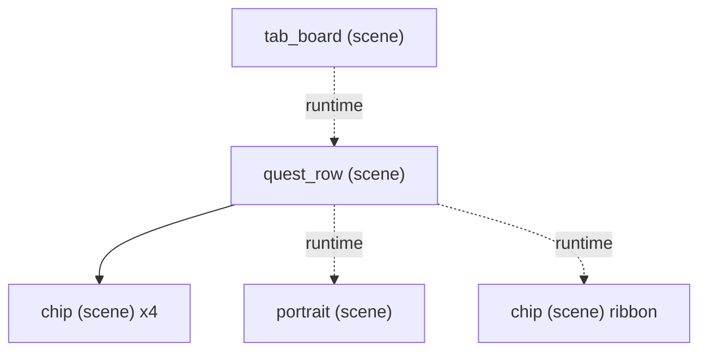

# quest_row.tscn

## Purpose
One quest on the Board, drawn as a scroll with the quest's facts on the left and its state and odds on the right. Tapping it opens Assign Party. Belongs to [[Party Drafting and Assignment]].

## Parent scenes
- **Placed in editor:** none.
- **Instanced at runtime:** by [[tab_board#_show_quest_list]] (`tab_board.gd:123`), which hands the preloaded scene to `HallStyle.add_row`. The parent scene is [[tab_board (scene)]].

## Child scenes
- **Placed in editor:** [[chip (scene)]] at `Row/BodyMargin/Body/Content/Info/Chips/RankChip`, `GoldChip`, `SlotsChip`, `FavChip`.
- **Instanced at runtime:** [[portrait (scene)]] per party member, created by [[quest_row#_show_party]] (`quest_row.gd:117`); a [[chip (scene)]] story ribbon, created by [[quest_row#_show_story_look]] (`quest_row.gd:105`).

## Node tree
- `QuestRow` (PanelContainer), script [[quest_row]]
  - `Row/BodyMargin/Body/Content`: layout (summarized); `Body` is the paper restyled for story quests
    - `%TypeSeal` (PanelContainer) with `%TypeTag` (Label) and `%TypeIcon` (TextureRect): set in [[quest_row#_show_quest_facts]]
    - `Info`: `%Title` (Label), and `Chips` holding `%RankChip`, `%GoldChip`, `%SlotsChip`, `%FavChip` (all [[chip]])
    - `%StateCol` (VBoxContainer): `%StateLabel`, `%OddsLabel` (Labels), `%Party` (HBoxContainer that holds the runtime portraits)

## Scripts attached
- Root: [[quest_row]]. `setup(hall, quest_index)` fills it from `hall.quest_entries`.
- Other nodes: [[chip]] on the four chips.

## Resources used
- Textures `Sprites/UI Textures/roller_v.png`, `Sprites/Hall Icons/flag.tres`.
